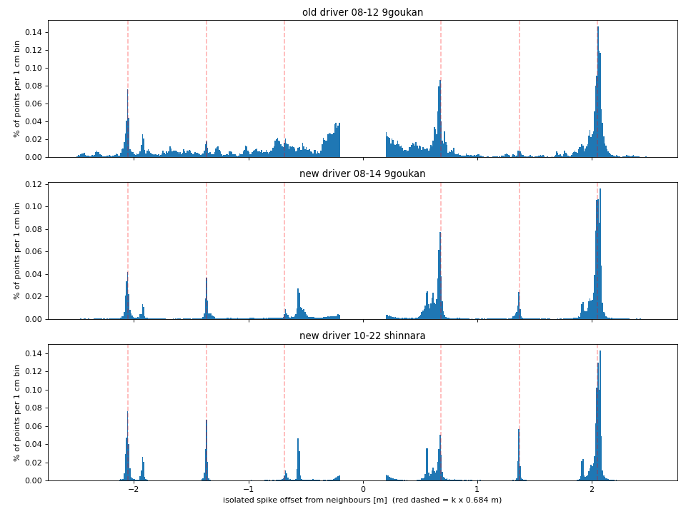
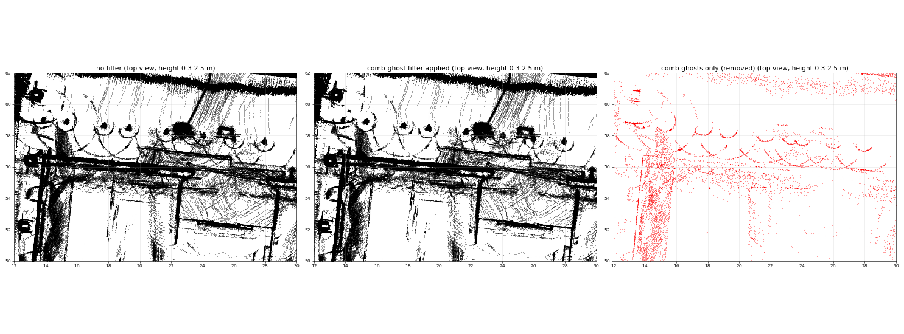
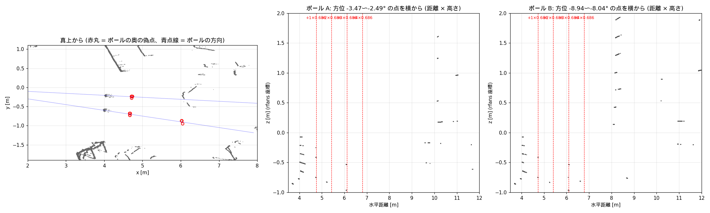
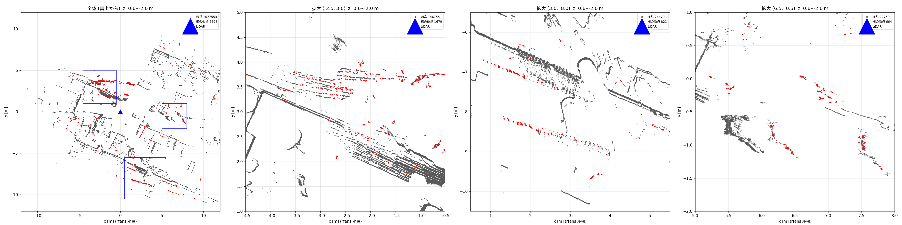
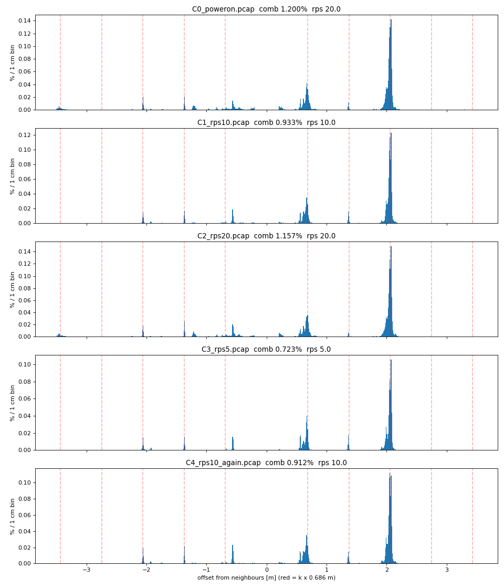
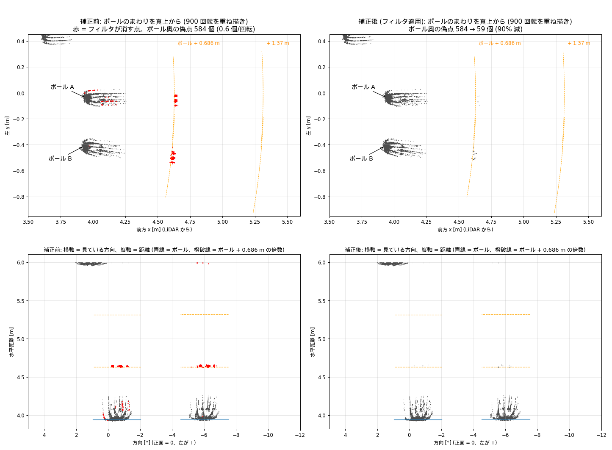
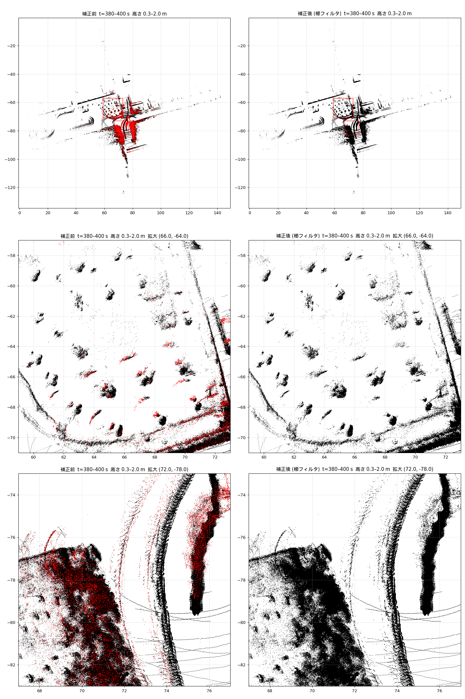
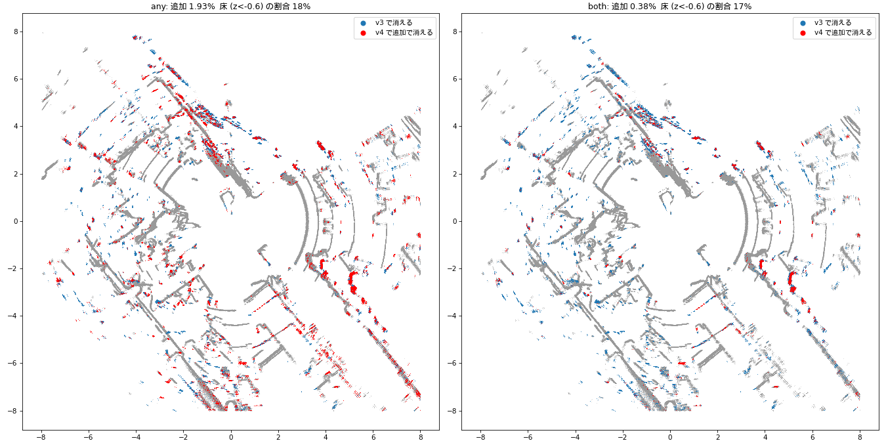
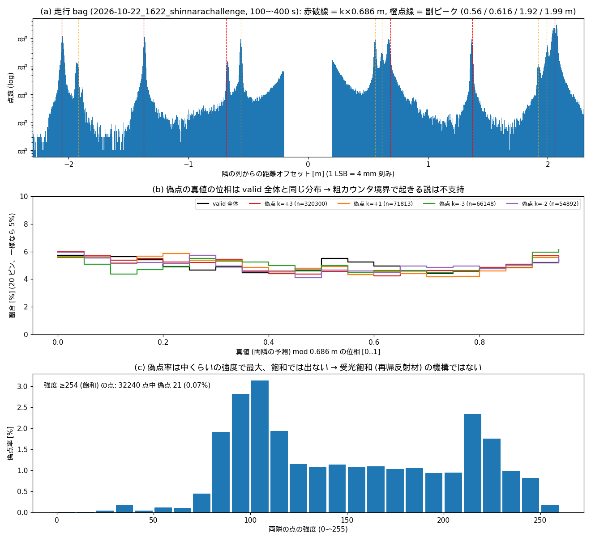

<!-- claude: 2026-10-25 作成 -->
# R-Fans 点群の「櫛状」距離偽点 — 木の幹・柱の周りに出る筒の正体

**ステータス: 本命 (critic 査読済み、因果は一部確認)**。地図で木の幹・柱の周り半径 +0.5〜1 m に出る筒状の点は、R-Fans-16 (0x5C) の生点群に含まれる単発の距離偽点。偽点の距離は隣の点から離散的なオフセット (約 0.68 m の倍数) だけずれている。視点ごとに幹の手前・後ろの空いた空間に落ちるので、重ねると筒に見える。
**追記 (10-27、§7.7 (c)、critic 査読済み)**: **シングル/デュアルエコーでも偽点の率は変わらない** (±2% 以内)。デュアルの近い側エコーとシングルで k の内訳まで同じ。k=+3 の一部 (約 23%) では「真値の反射は別エコーとして報告されていない」= 2 つ検出した反射から選び間違える機構は支持されない。残りの k=+3 と k=±1/±2 は、分離能 (約 1.9〜2.6 m) 内でまとめて選んでいる可能性を棄却できない。
**追記 (10-26、§7.7、critic 査読済み)**: 室内静止 1 シーンの実機検査で、**回転数 (rps 5/10/20) とドライバの書き込みの有無では、偽点の率に約 ±5% を超える差は見えなかった**。rps で率が変わって見えたのは点間隔の見かけ (§7.7)。ただし**エコー設定 (シングル/デュアル) は全条件でシングルのため未検証**。正面 4 m のポールの真後ろ +0.69 / +2.06 m に偽点を直接確認した。
**追記 (同日夜、§6、critic 査読済み)**: 発生段 = **センサ本体 (本命)**。生 UDP パケットの range フィールドの段で既に櫛があり、独立した 2 つのデコーダ (旧 libstar / 新 bufferDecode) で同じ櫛が出るので、ドライバのデコード由来はほぼ棄却。08-12 (旧ドライバ時代) から存在するので、08-14 のドライバ刷新は引き金ではない。ただし旧・新ドライバはどちらもデバイスに level3・シングルエコー・10 Hz を書き込んでいるため、**デバイス設定への依存は未検証** (実機でのみ判定可能)。地図の「ゴミ」のうち、木の周りの弧はこの偽点だが、ゴミ全体に占める割合は小さい (構造物から離れた占有セルの約 4%)。

**追記 (10-29、§9、critic 査読済み)**: bag/pcap だけで機構を絞る追加検査。**受光飽和が主因である説は不支持** (強度 ≥254 の点の偽点率は全体の 1/7〜1/15)、**粗/細カウンタ境界説は「真値の位相に固定した山は無い」が発光が非同期なら識別力ゼロで未棄却**、**格子は |k|=2,3 から P≈0.685 m、副格子 ±0.56 m (140 LSB) は 2 地点で同位置 = センサ由来だが主格子と同じ機構とは言えない**。**k=−3/−1 の「偽点」の 1〜3 割は「中心が本物で両隣 4 列が +|k|P の偽点の連」のラベル反転** (k=+3 との鏡像対称) — 櫛フィルタで k<0 を落とすと本物を消す恐れがある。静止 pcap と bag の両方に「1 パケット欠落」が数回/45 s ある (§9.6)。
**追記 (10-31、§10)**: **ユーザ決定: ゴースト点は消さず、含めたまま自己位置推定に使う。櫛フィルタはオフライン専用 (`rfans_comb_filter_bag.py`) に留め、live スタック (bringup / GLIM / nav) には組み込まない** — 「フィルタの副作用の方が嫌」。根拠 = 5 号館 10-09 1643 bag で幹の輪 (樽) の捕捉率を塊幅別に測ると **3 列以上連なる輪は 0 %、孤立点でも 26〜56 %** (現行フィルタは孤立点専用で樽には設計上効かない)。偽点は全レーザ・全方位にショット単位で出て、特定レーザ・特定方位・周期性のいずれでもない。弱い反射で増えることもない (強度 <80 で 0.2〜0.8 %、80〜160 で 4〜5 %、強度は両隣の本物と同じ)。壁の二重化は SLAM の位置合わせずれ (B) の可能性もあり未切り分け。

- 発端: ユーザ「建物の柱や木の幹の少し離れた周りに筒状の点が出る」「+0.5〜1 m 半径の大きい同心の円」。GLIM の default / fixed / fixed2 すべてで出る (ユーザ観察)
- 対象: bag `bags/raw/2026-10-22_1622_shinnarachallenge`、dump `bags/glim/2026-10-22_1622_shinnarachallenge_dump/seg_default_S1`
- 解析スクリプト: `bags/tools/2026-10-25_rfans_comb_and_slip/` (`ring*.py` / `echo.py` / `spike.py` / `parity.py`、critic の検査は `critic/`)
- 画像: `docs/issue/img/2026-10-25_rfans_range_comb_ghost/`
- ユーザ確認: `ring_side.png` の殻が「自分が見ていた筒と同じもの」

## 1. 何が起きているか

```
筒ができるまで
│
├─ ① 生点群 (/rfans_driver/rfans_points) の段で既に偽点がある
│    同じレーザの列方向に見て「両隣は揃っているのに真ん中の 1 点だけ距離が飛ぶ」点が 2.7%
│    (60 スキャン、48,404 / 180 万点)。飛び幅は連続分布ではなく離散値:
│      ±0.55 / ±0.67   ±1.37   ±2.05 (最多、+側)   ≒ 0.68 m の倍数
│    距離 1.5〜40 m・全レーザ・平らな面の内部でも同じ値 (critic 検査)
│
├─ ② 幹の場合: +0.6 m 前後の偽点は「センサから見て幹の後ろ」に落ちる
│    壁の後ろなら建物の中に消えるが、幹の後ろは空いた空間なので目に見える
│
└─ ③ 視点が回ると後ろ側の位置も幹の周りを回る → 重ねると半径 +0.6〜1 m の筒
     殻の高さ範囲は幹と一致する (幹の像がずれたものだから。樹冠ではない)
```

## 2. 証拠

| 証拠 | 結果 | 識別力 |
|---|---|---|
| 生スキャンを GLIM のフレームごとの姿勢で配置 (deskew なし) | 殻は既にある。フレーム時刻とともに滑る弧になる (`ring_frames.png`) | **あり** — GLIM の推定が原因という説を棄却 |
| (time, laserid) の重複 | 0 件 | **あり** — デュアルエコーの混入を棄却 (`use_double_echo: false`) |
| 偽点の距離オフセットの分布 | 離散ピーク、距離に依存しない (`spike_filter.png` 右上) | **あり** — 実物体・混合画素では作れない |
| 孤立スパイク除去 (同じ lid の時刻順で両隣が 0.1 m 以内に揃い、中央が 0.2 m 以上ずれる点を落とす) | 幹 (18.0, 58.6) の周りの弧はほぼ全部消える。(5.5, 61.4) は一部残る (`spike_filter.png`) | 因果を**一部**確認 |
| 幹ごとのペア解析 (`ring_ray.png`) | 同じ lid・隣の列で距離 +0.56〜0.70 m | 傍証 — 0.3〜1.0 m の窓で切っていたので +1.37 / +2.05 を最初から捨てていた |
| 偽点の intensity | 幹 139 vs 137。面全体では 116 vs 134 | 傍証 — 識別には使えない |

**棄却した仮説**:
- 偶数/奇数レーザの水平角補正表 (`HANGLE_V6BC_16G_0x57` の 6.01 / 3.377) の誤り → 40 スキャンで偶奇の最適相対回転が 0.00〜0.25° (誤りなら 2.63° 出るはず) (`parity.py`)
- GLIM 設定への依存 → 3 設定すべてで出る
- 樹冠 → 殻の高さ範囲が幹と一致する
- 「幹の輪郭の隣の列に固有」(初回の説明) → 平らな面の内部でも同じオフセットで出る (critic)。撤回
- 距離値のビット化け → LSB は 4 mm。ビット化けなら 0.512 / 1.024 / 2.048 m に出るはずだが 1.024 にピークがなく、1.36 m は 0.68×2 にしか合わない (critic)。約 4.5 ns の時間量子 (往復 0.68 m) のずれの可能性

## 3. 棄却できていない代替仮説

1. **幹の後ろの実物体が一部に混ざっている** (鳥居型・八掛支柱、植栽枠、ガード)。幹 (5.5, 61.4) でフィルタ後に残る殻がこれかもしれない。
   - 判定方法: 殻の点が常に「幹から見てセンサの反対側」を回るか (偽点)、世界座標で固定の方位に留まるか (実物) を見る。
2. **発生段がセンサ内部 (時間計測・エコー選択) かドライバのデコードか** — 未分離。
   - 判定方法: 実機の UDP を tcpdump で 10 秒取り、`calcXyz` を通す前の距離フィールドで同じスパイク統計を取る。
3. 未確認の予測 (棄却実験を兼ねる):
   - 幹の周り半径約 2.2 m に第 2 の殻がある (+2.05 が最多のピークだから)。
   - 壁の手前 0.57 / 1.37 / 2.06 m に薄い偽の壁がある (負のオフセット分)。Nav2 の costmap にはこちらの方が害が大きい可能性がある。

## 4. 影響と対策案 (未実装)

- 影響: 2D 地図・costmap で木や柱の周りに偽の輪の障害物が出る。手前側の偽点は偽の壁になりうる。GLIM の照合への影響は点数比 (約 3%) から小さいと見ているが、未検証。
- 対策案: 同じレーザの列方向に 1 次元の孤立スパイク除去をかける (`spike.py` の `spikes()`)。輪郭の点向けに「オフセットが櫛の値 ±0.55〜0.70 / ±1.37 / ±2.05 (±0.03) に一致するか」の判定を併用する。
  - 「隣の列より 0.5〜0.8 m 遠い点だけ落とす」案は、+1.37 / +2.05 (最多) と負側を取りこぼすので不可。
  - 副作用: 遠方の 1 列幅の細い実物体を消す恐れがある (0.2° は 20 m で 7 cm 相当。細いポールなど)。
  - 入れる場所の候補: ドライバ出力 (`cloud_node`) か、2D 変換・GLIM 前処理。

## 5. 次の一手

1. 残った殻の方位検査 (§3-1)。bag だけでできる。
2. 半径約 2.2 m の殻と、壁の手前の偽の壁の確認 (§3-3)。dump だけでできる。
3. 実機をつないだときに UDP を tcpdump する (§3-2)。
4. フィルタを試作し、2D 地図での輪の消え方と、細いポールが消えないかを確認する。
   - §6.4 の厳しい判定 (両側 2 点の直線あてはめ) では、幹の輪郭の偽点を取りこぼして弧が残る。輪郭用の判定が必要。**次の作業の有力候補 (2026-10-25 ユーザ指示)。`exp/glim-gpu-imu` ブランチではやらず、別ブランチで着手する。**

## 6. 発生段の調査 (2026-10-25 夜、critic 査読済み)

発端: ユーザ「円環はセンサデータの正確さという面で非常に重要だから原因を調査してほしい。SLAM 地図にやたら点群のゴミがあるのも関係あるかもしれない」。
スクリプト: `bags/tools/2026-10-25_rfans_comb_and_slip/` (`pkt.py` / `pkt2.py` / `pkt3.py` / `phase.py` / `oldnew.py` / `combmap.py`)。

### 6.1 生 UDP パケットの段で既に櫛がある — デコード由来はほぼ棄却

- bag の `/rfans_driver/rfans_packets` (RfansPacket、udp_size 1206 × 32、devid 0x5C) を `PACKET_USER_SIMPLE_S` (`ssFrameLib.h:577-594`) として自前でデコードした。
- ドライバのデコード (`bufferDecode.cpp` `processPacketUserSimple`) は `range(u16) × 0.004` だけで、171 LSB の離散的なずれを作る余地がない。
- パケットの range フィールドで、同じレーザの列方向に孤立スパイクを数えた (200 msg = 76,800 group)。
  - |off| > 50 LSB のスパイクは 3.54%。ただし植生・輪郭などの連続成分を含むので、この値を偽点率として扱わないこと。
  - 上位のオフセットは +168 / −341 / ±515〜518 LSB (1 LSB = 4 mm)。
- パケット内の位置 (group 0〜11、前半/後半の列、bundle 内の packet 番号) に依存しない (3.3〜3.75%)。転送や並べ替えの誤りなら group 単位で全レーザ同時に出るはずなので、それも棄却。
- 旧ドライバ (旧 libstar SDK) と新ドライバは独立したデコーダだが、どちらでも同じ櫛が出る (§6.2)。

### 6.2 08-12 (旧ドライバ時代) から存在する — ドライバ刷新は引き金ではない。設定依存は未検証

Drive から取り寄せた 2 本 (`bags/raw/2026-08-12_9goukan` = 旧ドライバ `/sdk_could`、`bags/raw/2026-08-14_0448_9goukan` = 新ドライバ) と、新習志野 bag を比べた。判定は同じ (列方向の孤立スパイク、`oldnew.py`)。

| bag | ドライバ | 櫛に一致する点 / 平滑な三連 |
|---|---|---|
| 08-12 9 号館 | 旧 | 1.77% |
| 08-14 9 号館 | 新 | 1.28% |
| 10-22 新習志野 | 新 | 1.38% |



- 3 本とも ±0.68 / ±1.37 / ±2.05 m に鋭いピークがある。
- 率の差はシーン依存が大きいので、ドライバ差・設定差として解釈しないこと。
- ⚠️ 旧ドライバ (`StarROS2/src/rfans_driver.cpp` の `configDeviceParams`) も新ドライバ (`surestar_rfans_ros2/src/rfans_driver.cpp:190-230`) も、起動時にデバイスへ level3・シングルエコー (`LEVEL3_ECHO`)・10 Hz を書き込む。3 本はすべて同じデバイス設定なので、**data_level / rps / エコー設定が引き金かどうかは未検証** (critic)。

### 6.3 櫛の規則

- オフセットは約 168〜172 LSB (0.67〜0.69 m、往復 ≒ 4.5 ns) の倍数付近に集中する。
  - オフセット ÷ k の中央値: k=1 で 166.5、k=2 で 170.5、k=3 で 171.7 LSB。±685 / ±855 も少数ある。
- k=+3 (+2.06 m) が最多。正負は非対称で、+1・+3 は正側、−2 は負側が多い。
- k=1 の正側だけ 130〜170 LSB に幅広く分布する (§1 の「+0.55」の山)。定数項が乗っているか、k=1 だけ別の機構の可能性がある (critic)。
- 偽点の intensity は真の面とほぼ同じ (133 vs 135)。弱い別エコーではなく、同じエコーの時刻を取り違えたように見える。
- 率はシーン依存が強い。
  - 近距離の地面 (laser 0・1) ではほぼ 0。上向きのレーザ・木・建物・intensity 100〜200 で高い。
  - レーザ・距離・強度の効果は交絡していて分離できていない (`pkt3.py`)。
- 真の距離の位相 (range mod 0.686) について、16 レーザを合算した分布は一様。ただしレーザ別には非一様の兆候があり、検定力も不足している。発光とクロックの同期も不明なので、**粗/細カウンタ境界での取り違えは棄却できていない** (critic)。

### 6.4 地図の「ゴミ」への寄与 — 木の周りの弧はこれ、ゴミ全体の中では少数

`combmap.py`: S1 の submap 6〜17 の生スキャン (3 枚に 1 枚、656 枚) を、GLIM のフレームごとの姿勢で重ねた。

- 偽点判定は櫛だけに限った: 両側 2 点ずつの直線あてはめ残差 < 0.04 m、かつ |off − k·0.686| < 0.06 m (k = ±1〜±5)。
- 櫛の偽点は全点の 0.69%。それ以外の孤立スパイクは 0.30%。
- 2D 占有格子 (5 cm、高さ 0.3〜2.5 m、3 ヒット以上で占有) をフィルタ前後で比べた。
  - 消えた占有セル: 1,936 / 89,840 (2.2%)。うち 67% は密な構造物から 0.3 m 以上離れたセル。
  - 構造物から 0.3 m 以上離れた占有セル (≒ ゴミ) のうち、櫛フィルタで消えるのは **約 4%** (31,201 → 29,901)。
- 判断: 木の周りの弧 (`combmap.png` 右の赤) は櫛の偽点そのもの。ただし地図の「ゴミ」の大半は別の原因 (植生、地面のスキャン線、人、姿勢の滑りなど) で、未分離。
  - ゴミの定義 (密な構造物から 0.3 m) は粗い。
- フィルタの課題: この厳しい判定では、幹の輪郭の偽点 (両隣が揃っていない) を取りこぼし、フィルタ後も弧が残る (`combmap.png` 中央)。



### 6.5 残る代替仮説 (センサ内部のどの段か) と次の一手

- センサ内部の候補 (どれも結論「センサ本体」は変えない):
  - 受信波形のリンギングや副ローブで検出位置が飛ぶ (サンプリング約 218 MHz 相当)。
  - 最強エコー選択の誤り。
  - TDC の粗カウンタの取り違え。
- 光学クロストーク (別チャネルのエコーの取り込み) は、ずれが 171 LSB に量子化されることと合わないので弱い。
- 次の一手:
  1. **実機で UDP を tcpdump して設定依存を判定** → 手順は §7。
  2. bag だけでできる作業: レーザ別・k 別の位相ヒストグラムをブロックブートストラップで検定する。off = a + k·b の回帰で a ≠ 0 かを見る。偽点の距離が同じ列の他レーザの距離と一致する率を偶然と比べる (クロストークの棄却)。
  3. メーカー (SureStar) への問い合わせ材料: `oldnew.png` と §6.3 の数値。
  4. 除去フィルタ (別ブランチ): 輪郭用の判定を追加し、櫛の値だけを落とす。

## 7. 実機検査の手順 — 偽点は設定で変わるか (別 PC・main ブランチで実施予定)

<!-- claude: 2026-10-26 追加 -->

### 7.1 何を確かめるか

§6.2 のとおり、これまでの bag はすべて「level3・シングルエコー・10 Hz」の同じ設定で録られている。そこで、設定を変えて偽点の率が変わるかを見る。

- 変わらない → センサ固有の現象。対策は除去フィルタとメーカーへの問い合わせ。
- 変わる → 一番安い対策は設定の変更。どの設定かも分かる。

測るのはセンサから届いた生の UDP パケットそのもの (tcpdump)。ドライバのデコードは一切通さない。

### 7.2 準備

- main を pull して `docker compose up -d main`。解析ツール `tools/rfans_comb_check/rfans_comb_check.py` は main コンテナ内で動く (numpy を使うため。pcap の読み込みに ROS は不要)。
- ホストに tcpdump が無ければ `sudo apt install tcpdump`。
- LiDAR がつながっている NIC 名を調べる: `ip -br addr | grep 192.168.0.` (以下 `<IF>`)。
- 保存先: `mkdir -p bags/rfans_check/$(date +%F)`。`bags/` は git 管理外。
- **場所**: 3〜15 m 以内に木や柱があり、人が通らない場所。ロボットは動かさず、全条件を同じ位置・同じ向きで録る。
  - 偽点の率はシーンで大きく変わる (§6.3)。途中で動かすと、設定の差とシーンの差が混ざる。
  - 屋外の木の近くなら率が高く (約 1%)、差を見やすい。
- モータ (CAN) は不要。LiDAR の電源だけ入れる。

### 7.3 録る条件 (この順番で)

| 記号 | 条件 | 操作 | ファイル名 |
|---|---|---|---|
| C0 | 電源投入直後 (ドライバ未起動) | LiDAR の電源を入れ直し、15 s 待って回転が落ち着いてから録る | `C0_poweron.pcap` |
| C1 | rps=10 (現行) | ドライバを `rps:=10` で起動 | `C1_rps10.pcap` |
| C2 | rps=20 | ドライバを止めて `rps:=20` で起動 | `C2_rps20.pcap` |
| C3 | rps=5 | ドライバを止めて `rps:=5` で起動 | `C3_rps5.pcap` |
| C4 | rps=10 (2 回目) | ドライバを止めて `rps:=10` で起動 | `C4_rps10_again.pcap` |

- C0 を最初にする理由: ドライバは起動時にセンサのレジスタを書き換える (data_level・エコー・回転数)。書き換えは電源を切るまで残るので、「ドライバが何も書いていない状態」は電源投入直後にしか録れない。
- C0 のセンサは内部既定の 20 Hz で回る (`2026-09-02_rfans_scan_motor_dropout.md` §未解決の周辺観測)。そのため C0 は C2 (rps=20) と比べる。
- C4 は C1 と同じ条件の録り直し。C1 と C4 の差が、この検査のノイズの大きさになる。

### 7.4 1 条件の録り方

```bash
D=bags/rfans_check/$(date +%F)

# (C1〜C4) ドライバだけ起動。bringup は使わない (モータ不要)。別端末で:
docker exec -it rerobot_env bash -lc "source /opt/ros/jazzy/setup.bash && source /workspace/install/setup.bash && \
  ros2 launch surestar_rfans_ros2 rfans_driver.launch.py rps:=10"
# → 10 s 待って回転が落ち着いてから ↓

# 45 s 録る (C0 はドライバを起動せずに、これだけ実行する)
sudo timeout 45 tcpdump -i <IF> -Z $USER -w $D/C1_rps10.pcap 'udp and src host 192.168.0.3'

# 録れたか確認: 10 Hz なら約 780 パケット/s → 45 s で約 35,000 個
tcpdump -r $D/C1_rps10.pcap -nn 2>/dev/null | wc -l
tcpdump -r $D/C1_rps10.pcap -nn -c 5 2>/dev/null   # 末尾の length が 1206 であること

# 終わったらドライバを Ctrl+C で止め、rps を変えて次の条件へ
```

- `-Z $USER` を付ける理由: 付けないと tcpdump は書き込み時に tcpdump ユーザへ権限を落とすので、自分のディレクトリに書けずに失敗することがある。
- **C0 で 1 パケットも来ない場合**: センサは「開始」の指令が来るまで送信しない、ということになる。この場合、C0 は判定不能として記録して次へ進む。
- **C0 でパケットは来るが length が 1206 でない場合**: 電源投入時の既定形式は level 3 ではない。その長さを記録しておく (ツールは 1206 byte しか解析しない)。

### 7.5 解析

```bash
docker exec rerobot_env python3 /workspace/tools/rfans_comb_check/rfans_comb_check.py \
  --png /workspace/$D/comb.png --json /workspace/$D/comb.json \
  /workspace/$D/C0_poweron.pcap /workspace/$D/C1_rps10.pcap /workspace/$D/C2_rps20.pcap \
  /workspace/$D/C3_rps5.pcap /workspace/$D/C4_rps10_again.pcap | tee $D/comb.txt
```

主な出力 (条件ごと):

| 項目 | 意味 |
|---|---|
| `rps_est` | 実際の回転数 (方位角の一周回数から計算)。指令どおりに回っているかの確認 |
| `comb_pct` | 櫛の偽点 ÷ 判定できた点 [%]。**主な比較対象** |
| `comb_pct_block_sd` | 1 秒ごとに区切った率のばらつき |
| `other_spike_pct` | 櫛に合わない孤立点 [%] (植生など)。シーンが変わっていないかの目安 |
| `k_hist` | ずれが 0.686 m の何倍か (k) の内訳。現行では k=+3 が最多 |
| `per_laser_pct` / `per_range_pct` | レーザ別・距離別の率 |
| `comb.png` | ずれの分布。赤の破線 (0.686 m の倍数) にピークが乗っているか |

参考 (10-22 新習志野、走行中 30 s): rps_est 10.02、comb_pct 0.97%、1 秒ブロックの sd 0.10、k=+3 が 18,310 / 29,248。
ツールの動作確認として、bag のパケットと、それを pcap に書き出したものの両方で同じ値が出ることを確認済み。

### 7.6 判定

1. まず C1 と C4 の差を見る。これがノイズの大きさ。
   - 差が大きい (例: 0.3 ポイント以上) 場合は、シーンが動いている。場所を変えて録り直す。
2. C2・C3 を、C1 と C4 の平均と比べる。
   - 差がノイズの 3 倍を超えていれば「rps で変わる」。
   - 率だけでなく `comb.png` のピーク位置も見る。0.686 m の間隔が rps で動くなら、櫛の間隔はセンサ内部の時間基準と結びついている。
3. C0 を C2 (同じ 20 Hz) と比べる。
   - C0 だけ違えば、ドライバが書き込むレジスタ (data_level / エコー) が引き金になっている。
4. 結果の書き方:
   - `comb.txt` の末尾にある条件比較表と `comb.png` をこの節の下 (§7.7) に貼る。
   - C0 のパケットの有無・length も書く。
   - pcap は `bags/rfans_check/` に残す。必要なら Drive (`cit-share-bags:bags/`) に上げる。

### 7.7 結果 (2026-10-26、室内静止、critic 査読済み)

<!-- claude: 2026-10-26 追記 -->

- **場所と録り方**: 室内で、ロボットは静止、周囲は無人。ホストの tcpdump は sudo のパスワードが要るため、main コンテナ内の root で生 UDP を録った (`tools/rfans_comb_check/rfans_capture.py`、AF_PACKET。形式は tcpdump と同じ pcap)。
- **データ**: `bags/rfans_check/2026-10-26/run2/` (pcap 5 本、`comb.json`)。間引き検査は同じ場所の `../scripts/decimate.py`、録画の手順は `../scripts/run_conditions.sh`。
- **C0**: パケットは来た。長さは 1206 byte で、ほかに 256 byte のパケットが約 1 個/s。rps_est は 20.0。

#### (a) ポールの奥に偽点が出ることを直接確認

正面 4 m に細いポールを 2 本置き、rps 10 の点群を 15 s 録った (`poles_rps10_bag`)。

- 2 本ともポールの真後ろ **+0.69 m**、ポール B はさらに **+2.06 m** (k=+3) に偽点が出た。
- 偽点はセンサからポールへの視線の上にあり、高さはポールと同じ。出るのはポールに当たっているレーザ (5・6 番) だけだった。
- 方位の幅をポールより広げても、偽点の数は増えない (実物ならその距離に点が増えるはず)。
- 偽点の数は、ポールの点 約 400 点あたり 5〜9 点。
- ポール A の 6.1 m には少し横に実物があるので、そこの点は偽点かどうか判定できない。
- 静止していると、偽点は弧にしかならない。円環になるのは、ロボットが動いて視線が回るとき。
- 率の判定 (両隣の平滑) では、細いポールの輪郭の偽点は数えられない (§6.4 と同じ取りこぼし)。上の偽点は、ポールの方位の楔の中で距離の分布を数えて確認した。



<!-- claude: 2026-10-28 図を追加 -->
室内全体 (C1、rps 10) を真上から見ると、壁の手前・奥に平行な「偽の壁」が点線状に並ぶ (赤 = 櫛の判定に掛かった点)。



#### (b) 条件比較

録った順は C0 → C1 → (C1 のドライバが約 10 分動き続けた) → C2 → C3 → C4。

| 条件 | rps | comb% (そのまま) | 1 s sd | other% | 点間隔を 20 Hz にそろえた comb% |
|---|---|---|---|---|---|
| C0 電源投入直後 | 20 | 1.200 | 0.024 | 0.486 | 1.199 |
| C1 | 10 | 0.933 | 0.021 | 0.283 | 1.183 (×2 間引き) |
| C2 | 20 | 1.157 | 0.020 | 0.484 | 1.157 |
| C3 | 5 | 0.723 | 0.015 | 0.217 | 1.129 (×4 間引き) |
| C4 | 10 | 0.912 | 0.019 | 0.298 | 1.147 (×2 間引き) |



**分かったこと**:

- **そのままの率は rps で 0.72 → 0.92 → 1.16% と変わるが、これは見かけ**。
  - 偽点は角度方向に約 0.4° の塊で出る。点間隔が細かい (rps が低い) と、両隣も偽点になって孤立点の判定から外れる。
  - 列を間引いて点間隔をそろえると、率は 1.13〜1.20% に収まる。偽点の塊の統計 (隣の列も偽点である確率) も、C3×4 が 0.338、C2 が 0.343 で一致した。このため、間引いた比較は公正と言える (critic)。
- **櫛の間隔は全条件で一定**。k=±2・±3 の off/k は 170.4〜171.3 LSB (≈0.684 m) で、rps にも出力形式にもよらない。
- **C0 と C2 の違いは「包装」だけ**。
  - group flag が違う (C0 は 0xFFEE = V6G 形式、ドライバ起動後は 0xC01E = data_grade 3)。
  - 一方、(レーザ, 方位) で照合した距離と強度の値は同じで、エコーは両方シングル (critic)。

**言えないこと (限界)**:

- **エコー設定 (シングル/デュアル) は未検証**。全条件がシングル。data_level の差も、出力形式の差にとどまる可能性が高い。
- **rps は発光の時間割を変えない** (パケット/s と gps 間隔 1279 µs は全条件で同じ)。このため、時間系の機構 (TDC・クロック) の切り分けには使えない。
- **ノイズの床は 2〜4%**。同じ条件の再測 (C1 と C4) は 1 組しかなく、その差がそのままで 2.3%、地図で照合すると 4%。
  - 点間隔をそろえた値は録った順に 1.199 → 1.183 → 1.157 → 1.129 → 1.147 と下がっていく。電源投入直後の暖機によるドリフト (−3〜4%) と、C0/C2 の差 (+3.7%) は分けられない。
  - 効果があったとしても約 ±5% 以内、までしか言えない。
- 場所は室内の 1 シーンだけ。偽点は対象物で決まるので、屋外の木や遠距離では違う可能性がある。
- C1〜C4 では、ドライバの rps watchdog が速度指令を再送していた (calculation_node のクラウド受信が 1〜7 Hz に落ちていた)。C0 では再送はない。影響は小さいと見ているが未検証。
- 付随して分かったこと: 現行の判定は偽点を少なく数えている。±1 列を飛ばす判定 (wide) だと、実効 20 Hz で 1.37〜1.48% (厳しい判定の約 1.2 倍) になる。運用の 10 Hz ではさらに取りこぼす。除去フィルタの設計 (§6.5-4) では、塊 (約 0.4°) を前提にすること。

**棄却できていない代替仮説と、棄却実験**:

1. **エコー設定で率が変わる / 強エコー選択の誤り**: `use_double_echo:=true` で録り、偽点と同じ (レーザ, 列) のもう一方のエコーが真値に一致するかを見る。
   - 一致すれば、機構は「エコー選択の誤り」に絞られる。対策も「デュアルで近いほうを採る」に直結する。
   - 手順: 1 回の電源投入で、シングル 20 Hz → デュアル → シングル → デュアルの順に各 45 s、交互に録る。
   - 事前に、ツールがデュアルの形式 (方位の差 0 の対) を読めるようにする。
2. **暖機・温度による数 % のドリフト**: 電源投入後、20 Hz を 30 分連続で録り、5 分ごとの率を見る。
3. **小さな rps 効果 (C3 の −2〜3%) が実在する**: C2 と C3 を交互に 3 往復録る。
4. **シーン依存**: 屋外の木の近くで、同じ手順を交互の配置で録る。

#### (c) シングル / デュアルエコー (2026-10-27、critic 査読済み)

<!-- claude: 2026-10-27 追記 -->

§7.7 (b) の代替仮説 1 の検査。

- 録り方: 室内静止・無人で、rps 20 のまま S1 → D1 → S2 → D2 の順に交互で録った (各 45 s)。S は `use_double_echo:=false`、D は `true`。
- 場所: 10-26 とほぼ同じで、正面 4 m のポール 2 本は残っている。
- データ: `bags/rfans_check/2026-10-27/run_dual/` (`dual.txt`)。
- 解析: `tools/rfans_comb_check/rfans_comb_dual.py`。録画の手順は `../scripts/run_dual.sh`、分離間隔は `../scripts/sep.py`。

**デュアルの形式** (実データで確認):

- パケットは 1565/s で、シングルの 2 倍。group (0,1), (2,3), … が同じ方位の 2 エコーになる。
- 1 エコーあたりの点間隔はシングルと同じ。
- エコー a (偶数 group) は**常に近い側**のエコーで、最強のエコーではない。両方が出ている点で b<a は 0 点。強度は a>b が 81%。
- b は、2 つ目の反射が無いと 0 になる (92.8%)。または a の複製になる。
- **2 エコーの分離最小間隔は約 1.9 m** (|b−a| が 0.05〜1.90 m の対は 0 個)。レーザによっては 2.0〜2.6 m。レーザ 0/1 は対が出ない。

| 録り | comb% | 母数 |
|---|---|---|
| S1 シングル | 1.041 | 656 万 |
| D1 デュアル (エコー a) | 1.039 | 656 万 |
| S2 シングル | 1.027 | 656 万 |
| D2 デュアル (エコー a) | 1.032 | 656 万 |

**分かったこと**:

1. **偽点の率と k の内訳は、シングルとデュアル (エコー a) で ±2% 以内で同じ**。
   - k 内訳: S1 {−5:1604, −3:2715, −2:1537, −1:1771, +1:14855, +2:1512, +3:44317}、D1a {1552, 2693, 1561, 1712, 14770, 1664, 44184}。
   - 交互録りのドリフト (S1→S2 −1.3%、D1→D2 −0.7%) があるので、言えるのは ±2% まで。
   - ただしシングルが first-echo 規則なら、この実験はエコーの選択規則そのものを変えていない (「2 つ目の枠を足したか」だけ)。
2. **相方エコーの検査は k>0 には効かない**。a は常に近い側なので、k>0 (偽点が真値より遠い) の真値が b に出ることは構造上ありえない。
   - 「k=+1..+3 で相方=真値が 0」は証拠にならない (初回の私の解釈は誤り。critic が指摘)。
3. **識別力のある部分**: 分離能が約 1.9 m のレーザ (4,5,6,7,9,11,14) で、真値の距離が 3〜15 m の k=+3 偽点 (D1 10,293 個 / D2 10,321 個、k=+3 の約 23%) を見た。
   - これらの偽点は**最も近いエコー (a)** に出ている。2.06 m 手前の真値の反射は、別エコーとして報告されていない。
   - したがって「2 つの反射を別々に検出したうえで、誤った方を選ぶ」機構は、この部分については支持されない。単発の時刻ずれ (粗カウンタの取り違え、§6.5) とは矛盾しない。
   - 逆の組 (a = 平滑な真値、b = a + 3P) は 687 / 1082 個あるが、分離の立ち上がりの縁にあり、山はない。
4. **k=−5 で相方 = 真値の 403 / 452 個は、櫛の偽点ではなく実物の可能性が高い**。
   - 49 セル (レーザ 13/14、方位 358〜1.4°) に固定されている。
   - 強度は a 202 / b 43 と高く、b が背景の壁の距離に一致する。
   - 細い前景物と奥の壁の 2 面を見ていると読むのが自然。

**棄却できていない代替仮説**:

1. **分離窓内での選択**: 真値と偽ピークの間隔が分離能 (1.9〜2.6 m) 未満だと、1 つにまとめて誤った方を出す。
   - k=±1/±2 の全部と、k=+3 の約 77% (分離能 ≥2.05 m のレーザ、近距離) では棄却できない。
   - 棄却実験: **分離能の較正**。分離能が最小のレーザ 5/6 の高さに細いポールを 4 m に置き、背後の板または壁との間隔を 1.8 / 1.95 / 2.06 / 2.3 m に変えて、b が出る率を測る。
2. **選択規則 (first / last / strongest) で率が変わる**: この実験では規則を変えていない可能性がある。
   - 棄却実験: 規則を指定するコマンドが ssFrameLib や仕様書にあるかを確認する。あれば同じ交互録りで録る。
   - 確認結果 (10-27): `ssFrameLib.h:507-510` にパケット種別 `PACK_ID_STRONG_ECHO` (0x02 最強) と `PACK_ID_FIRST_ECHO` (0x03 第一) の定義がある。
     ただし、それを指定する設定コマンドは無い。ドライバが書けるのは `CMD_LEVELn_(DUAL_)ECHO` の最下位バイト 00 (シングル) / 02 (デュアル) だけ。
     仕様の分からない値を推測で書き込むのは避け、メーカーへの問い合わせ事項にする。
3. **シーン依存**: 屋外の木は未検証。
4. **a = 最初の有効な反射、という前提の穴**: a=0 & b>0 が 2.4% ある (強度 2〜6 の弱い近距離反射が最初の枠を埋めている可能性)。
   - 偽点が a の複製になっている例は強度 206 (偽点全体は 103) で、飽和との関連がありうる。

**その他の観測**: rps 10 の点群 bag が 10 Hz のところ 2〜4 Hz しか記録されなかった。pcap は全パケット録れているので、この検査には影響しない。記録側か calculation_node 側の問題として未調査。

## 8. 除去フィルタの試作 (2026-10-27、オフライン Python・ノード化は未)

<!-- claude: 2026-10-28 追記 (10-27 の試作結果。PROJECT_STATE §10 から転記して図を付けた) -->

- コード: `tools/rfans_comb_check/rfans_comb_filter.py` (`ghost_mask()`、1 フレーム単位)。pcap → 点群は `bags/rfans_check/2026-10-27/scripts/pcap_points.py` (発射時刻補正あり)、図は同じ場所の `clear_fig.py` / `moving.py`。
- 判定 (樹形図):

```
各点 (同じレーザの前後 5 列を見る)
├─ 水平の判定 (v3)
│   ├─ 左右の連続 2 点から中心へ直線で延ばした予測 (最大 8 個)
│   ├─ 予測が「この点の距離」に 1 つも乗らない (m0 = 0)
│   └─ 予測が「この点 − k × 0.686 m」に 2 個以上乗る → 候補
├─ 縦の判定 (v4 で追加)
│   └─ m0 = 0 で、上下「両方」のレーザの同じ方位に「この点 − k × 0.686 m」がある → 候補
└─ 救済: 上下どちらかのレーザに同じ距離 (±0.10 m) の点がある → 本物として残す
```

### 8.1 細いポールの奥 (室内静止、S1.pcap 900 回転)

- ポールの奥 +0.686 m の偽点: **584 → 59 個 (90% 減)**。全点の除去率は 2.58%。ポール本体の誤除去は 0.4%。
- v3 (水平の判定だけ) では 2/3 が漏れていた。細いポールの奥の偽点は、左右の隣が奥の壁なので、水平の予測が「奥の壁」側に揃ってしまうため。
- 図の下段 (方向 × 距離) で、橙の破線 (ポール + 0.686 m) に乗っていた赤の点が消えている。
- ポールの像が二重に見えるのは、このフィルタとは別の原因 (センサの方位の段差など、[2026-10-27_rfans_azimuth_step.md](2026-10-27_rfans_azimuth_step.md))。



### 8.2 走行 bag (新習志野 10-22、t = 380〜400 s を車輪 odom で重ね描き)

- 植え込みの横の三日月形の弧 (中段の赤) は消える。
- ただし植え込みの中 (下段左) も赤が多い = **本物の葉を消している疑い**。除去率 2〜3% が偽点率 1〜1.5% より多いのもこのため、と見ている (未確認)。
- 本物の誤除去率は未測定。決まった方位で毎回出る偽点があるので、「フレームをまたいで再現する点 = 本物」を正解に使えない。
- 遠くの物体がぼけているのは重ね描きに使った車輪 odom の向きのずれで、フィルタや LiDAR の問題ではない ([2026-10-27_rfans_azimuth_step.md](2026-10-27_rfans_azimuth_step.md) §4)。



### 8.3 縦の判定は「上下両方」を必須にした理由

- 片側のレーザだけで判定すると (左 any)、追加で消える点が 1.93% に増え、床 (z < −0.6) が 18% を占めた。床や斜めの面は、隣のレーザの距離がちょうど k × 0.686 m ずれる位置に来ることがあるため。
- 両側を必須にすると (右 both)、追加は 0.38%。
- 追加で消える塊のうち 5.6 m のもの (手前 3.55 m の物体の真後ろ +3P) は k=+3 の偽点と見ているが、隙間越しに見えた本物の可能性は否定できていない。



### 8.4 次の一手

1. 植え込みの過剰除去の対策 (葉は距離がばらつくので、予測の直線が乗りにくい)。
2. GLIM の前段に入れて、地図の木の周りの筒が消えるか比べる。
3. ROS ノード化 (別ブランチ)。

## 9. 再調査 (2026-10-29、bag/pcap のみ、critic 査読済み)

<!-- claude: 2026-10-29 追記。ユーザ「樽状異常点とポールのダブリをドキュメント等を読んで再調査して」 -->

発端: ユーザ指示「樽状異常点問題 (= §1 の筒) と回転ズレ (ポールのダブリ、[2026-10-27_rfans_azimuth_step.md](2026-10-27_rfans_azimuth_step.md)) を文書を読んで再調査」。実機は使わず、§6.5-2 に「bag だけでできる」と書いてあった項目と、critic が追加で求めた検査を回した。
スクリプト: `bags/rfans_check/2026-10-29/comb_mech{,2,3,4,5}.py` (結果は同じ場所の `*.txt`)、critic の検証は `critic/crit_*.py`。入力は静止 pcap (S1 20 Hz / C1 10 Hz、室内) と走行 bag (新習志野 10-22 1622 の 100〜400 s、packets 5.6 M 列)。critic はつくば 10-03 1126 seg1 でも副ピークを再現した。

### 9.1 要約 (樹形図)

```
偽点の機構について 10-29 に分かったこと
├─ 棄却・不支持
│   ├─ 受光飽和 (再帰反射材で位相式スキャナに出る Nonius jump 型) … 不支持 (§9.3)
│   │     強度 ≥254 の点の偽点率 0.07% (自分) / 0.15% (両隣が飽和) ≪ 全体 1.06%
│   └─ レーザ間の時間的クロストーク … 不可能 (§9.4)
│         発射表 DELTA_T_RFANS_V6K_16G_0x5C は 16 本すべて 3.33 µs 刻みの別時刻 (= 500 m 相当)
├─ 棄却できなかった
│   └─ 粗/細カウンタ境界の取り違え … 真値の位相に固定した山は無い (走行 bag) が、
│         発光がカウンタクロックと非同期なら位相検定に識別力が無い (critic)。k=±3 が最多なのは「1 カウントの取り違え」と合わない (主な反証)
├─ 新しい観測
│   ├─ 格子 (§9.2): |k|=2,3 から P ≈ 0.685 m。k=1 は −3 LSB 短い。副格子 ±140 LSB (0.56 m) は 2 地点で同位置 → センサ由来
│   │     だが ± 対称・距離依存が主格子と違う → 同じ機構とは言えない。|k|=2 には副ピーク無し
│   ├─ 2 面場面との関係 (§9.5): k=−3/−2 の偽点の 81〜86% は隣接レーザが c の P 以内に実面を見る (通常点の対照 8%)
│   │     k=±1 の高率は基準率と同じで証拠にならない。k=+3 は 2 倍 (21〜31% vs 11〜17%)
│   └─ ラベル反転 (§9.5): k=−3/−1 の 1〜3 割は「中心が本物、両隣 4 列が +|k|P の偽点の連」(k=+3 と鏡像)
│         → 偽点は主に + 側 (遠い側) で、k<0 の一部は検出器の見間違い
└─ フィルタへの含意 (§9.7)
    ├─ v4 の救済規則 (上下隣接レーザに ±0.10 m) に掛かる comb 偽点は走行で 9.3% (k=+3 は 5.7%) — k<0 の分は反転なら正しい救済
    └─ k<0 を「偽点」として落とす設計は、本物を消して偽点の連を残す恐れ → k<0 は「両隣の連」を疑う側に回す
```

### 9.2 格子の精密な形 (走行 bag、1 LSB ヒストグラム)



- |k|≥2 の中央値 (S1 / C1 / 走行) からの回帰: b = 171.9 / 172.2 / 171.1 LSB (0.688 / 0.689 / 0.685 m)、a = −0.8 / −1.4 / +0.2 LSB。k=+1 の中央値は 168 LSB (b より 3〜4 LSB 短い)、k=−5 (S1) は +6〜7 LSB 長い。critic: a≈0 の線形格子は k=1..5 を同時には説明しない (a=−5.6、b=173.8 でも同程度に合う) ので、**b の有効数字は 3 桁 (0.685 m)、a は未確定**とする。
- 副ピーク (主格子からの差): +140 (−28 LSB)、+154 (−14)、+499 (−15)、+480 (−34)、−140 (+32)、−480/−484 (+30〜34)。**±140 LSB (0.56 m) は走行 bag で L4〜L15 にほぼ均等に出る** (静止室内では L5 に偏っていた = 場面) ので、場面由来ではなくセンサの格子。critic がつくば 10-03 seg1 でも ±140 (1869 / 1830 個) と +499・±480 を同位置で再現。
- ただし ±140 は ± 対称 (走行 9143 / 8622) で、主格子 (k=+3 : k=−3 ≈ 5 : 1) と非対称性が違い、距離依存も違う (±140 は 6〜20 m で多く 0.5〜3 m で少ない。k=+3 は 0.5〜20 m で平坦) → **主格子と同じ機構とは言えない**。細い実物 (柵・支柱) の可能性が戻るかは、±140 点の隣接レーザ分布を k=+3 と同じ手順で比べると判定できる (未実施)。
- ⚠️ 1 LSB ヒストグラムを `np.round` で作ると偶数 LSB が 2 倍に見える (半数偶数丸め。生 range の偶奇は 50.0%)。`floor(off+0.5)` に直すと「512/518 の二山」は 513〜520 の 1 山になる。図は修正済み。

### 9.3 強度・飽和 (受光飽和説は不支持)

| 条件 (走行 bag) | 偽点率 |
|---|---|
| 両隣の強度 <30 | 0.01% |
| 60〜150 | 1.3〜1.6% (最大) |
| 150〜200 | 1.0% |
| 自分の強度 ≥254 (飽和) | 0.07% (32,240 点中 21) |
| 両隣が ≥254 | 0.15% (n=26,200、critic) |

- 飽和した点ではむしろ出ない。ISPRS 2026 の「再帰反射標識の後ろに層状のゴースト (Nonius jump)」は位相式スキャナの飽和機構で、パルス ToF の本機には元々当てはまらない — **見た目が似ていても別物**。
- k 内訳は強度で変わる: 60〜100 では k=+3 が 78〜88%、200〜256 では k=+1 が 35〜39%・k=−3 が 25%。k=+3 の偽点は両隣より暗い (median 100〜103 vs 148〜150)。critic: 2 面場面の混合画素は強度が下がるので、強度は原因でなく結果の可能性がある。

### 9.4 位相検定とクロストーク

- 走行 bag で、偽点の真値 (両隣の予測) mod P の 10 ビン分布は valid 全体と ±10〜17% で一致し、k ごとにもどこにも山がない (図 (b))。静止室内で見えた強い偏り (k=−3 が位相 0.9〜1.0 に 43% 等) は特定の物体の距離との交絡 (走行で消える)。
- critic: 発光がカウンタクロックと非同期なら、境界のずれは毎ショット乱数位相で起き、真値 mod P は一様になる = **この検定では境界説を棄却できない**。レーザ別には ±40〜90% の緩い変調が別々の位相にある (距離層別の残差か位相依存かは 0.5 m 刻みの層別で判定可、未実施)。bag だけでできる次の検査: 各レーザの `c mod P` の 171 ビン分布 (全点) に周期的な凹凸 (DNL) があれば同期、無ければ非同期。
- レーザ間クロストーク: `calculation.h:307` の発射表は発射順 0,2,4,6,1,3,5,7,8,10,12,14,9,11,13,15 で全部 3.33 µs 間隔 (同時発射なし)。隣の発光の反射が自分の窓に入るには距離 500 m が要る → 不可能。「偽点の距離が同列他レーザの距離と一致する率 14〜30%」は §9.5 の 2 面相関であって、クロストークの証拠にも反証にもならない。

### 9.5 2 面場面との関係とラベル反転

同列の隣接レーザ (上向き 8〜15 だけ、地面の交絡を外す) が、偽点 c の P 以内に実面を見る率。対照は critic が置き直した「同列の通常点に c' = 真値 + kP を置いたときの率」:

| k | 奥 P 以内 | 手前 P 以内 | 対照 (同列通常点) |
|---|---|---|---|
| −3 | **81%** | 54% | 8% |
| −2 | 32% | **86%** | 8% |
| −1 | 84% | 49% | **75%** (基準率と同じ) |
| +1 | 20% | 82% | **78%** (同上) |
| +2 | 31% | 31% | 11〜17% |
| +3 | 22% | 30% | 11% |

- k=±1 の高率は「真値の近傍に同列の面があるか」と同じ質問 (窓が真値に重なる) で証拠にならない。k=−3/−2 は実在、k=+3/+2 は 2 倍。
- **ラベル反転の判定** (`comb_mech5.py`、critic 推奨): k=−3 の comb 点について隣接レーザ (l±1) の中心列が ≈c (±0.25P) を見る率は **34.6%** (≈真値は 6.0%)。k=+3 では鏡像で ≈c 4.8%・≈真値 33.7%。≈c の集合では、レーザ l の両隣 4 列が「隣接レーザの同列 + 3P」に乗る列が ≥3 のものが 37.7% (4/4 が 28%)。k=+3 の同じ集計は 14.3%。k=−1 も同じ形 (31% / 36.5%)、**k=−2 は違う** (7% / 15%、別物)。
- 読み: k=−3/−1 と判定した点の少なくとも 1〜3 割は「中心が本物で、両隣 4 列が本物の +3P (+1P) に飛んだ偽点の連」。検出器 (両隣 2 点ずつが直線) は「連」を本物と見るので、符号が反転して数えられる。鏡像対称 (35% ↔ 5%) からは大半が反転の可能性もあるが、隣接レーザが同じ面を見ない場面 (植生) では判定できないので「一部」に留める (critic 判定 (b))。
- 含意: 偽点は主に + 側 (遠い側) に出る機構で、k<0 の件数は偽点の連の副産物を含む。室内の平らな壁の手前に見えた「偽の壁」(§7.7 図) も、この読みなら「壁の +kP に出た偽の壁の連を、ドライバの孤立判定が手前と誤認した」可能性がある (未確認)。

### 9.6 パケット欠落 (録画スクリプト固有ではない)

- 静止 pcap の方位走査 (`az_glitch_all.py`) で「GPS 時刻差 2 パケット分 + 方位が 1 パケット分跳ぶ」= 1 パケット欠落が C1: 3、C2: 4、C3: 2、S2: 2、D1: 2〜3、D2: 5 回 / 45 s (C0・C4・S1 は 0)。
- critic: ドライバの UDP ソケット経路 (bag の packets) にも同じ穴がある (10-22 新習志野 53 個/300 s = 7.9/45 s、10-03 つくば 0.1/45 s) → `rfans_capture.py` (AF_PACKET) 固有ではない。穴は約 3 s 格子の固定位相に乗る録りが多い (機器の 1 Hz 状態パケット 256 B から −0.46 s)、C2 は非周期。watchdog 再送とは時刻が合わない。NIC (USB アダプタ)・カーネル・機器のどれかは未分離。最安の切り分け: 録画前後に `/sys/class/net/<IF>/statistics/{rx_dropped,rx_missed_errors}` と `ethtool -S` を読み、`rfans_capture.py` に `PACKET_STATISTICS` の tp_drops を出す。
- 影響: 1 パケット = 10 Hz で 4.6°・20 Hz で 9.2° の帯が 1 回転だけ抜ける。フレーム欠落 ([2026-09-26_rfans_single_frame_loss.md](2026-09-26_rfans_single_frame_loss.md) 系) とは別の、より小さい穴。

### 9.7 フィルタへの含意と次の一手

- v4 の救済規則 (上下隣接レーザに ±0.10 m の点があれば本物) に掛かる comb 偽点は走行 bag で 9.3% (k=−3: 32%、k=−1: 27%、k=+3: 5.7%)、室内 3.8%。k<0 の分がラベル反転なら「正しい救済」なので、実害は k=+3 の 5〜6% 相当。
- 設計変更の候補: k<0 の候補は「中心を落とす」のではなく「両隣 4 列が隣接レーザの面 +|k|P に乗っていないか」を見て、乗っていればそちら (連) を落とす。偽点の連 (0.4〜0.8°) は孤立判定 (両隣直線) からも漏れるので、連の検出が要る。
- bag だけでできる次の検査 (安い順): (1) ±140 点の隣接レーザ分布を k=+3 と比較 (細い実物か)。(2) 各レーザの `c mod P` 171 ビン分布で DNL の有無 (発光とクロックの同期判定)。(3) k=−3 の反転判定を l±2・5 列で再集計し「大半か一部か」を詰める。
- 実機が要るもの: 再帰反射テープを貼った細いポール (2 面あり) で S1 と同じ手順 → 偽点率が通常ポールと同じなら飽和無関係が確定。メーカー問い合わせの材料は §6.3 + §9.2 の格子 (P ≈ 0.685 m = 往復 4.57 ns、副格子 0.56 m、k=+3 最多、飽和では出ない)。

## 10. 5 号館 10-09 1643 bag でのフィルタ効果の定量と運用判断 (2026-10-31)

<!-- claude: 2026-10-31 追記。ユーザ「正直まだ輪っか結構残ってる」「新習志野のフィルタ前後を GLIM に掛けて 3D で見たが目視で違いが分からない」を受けて定量。スクリプトは bags/tools/2026-10-31_1643_combfilter/ -->

発端: Drive から `raw/2026-10-09_1643_5goukan_chal` (1166 s) を戻し `rfans_comb_filter_bag.py` でフィルタ版 `derived/2026-10-09_1643_5goukan_chal/combfilter` を作成 (全 350 M 点中 7.60 M 点 = **2.17 %** 除去、10 s 平均で 1.3〜3.5 %、植え込み区間ほど高い)。ユーザが「輪が残っている・GLIM 地図で差が見えない」と指摘 → 以下を測定。

### 10.1 幹の輪 (樽) の捕捉率は塊の幅で決まる

t=300–306 s の幹 (14.45, −46.6)・ポール・425 s の植え込み脇で、幹の方位幅の中にあり同じレーザの距離が「幹 + k × 0.686 m」(±8 cm) の点を輪の点とみなし、同じレーザで連続する列数別に捕捉率を出した (`ring_runlen.py`)。

| k | 1 列 | 2 列 | 3 列 | 4 列以上 |
|---|---|---|---|---|
| +1 | 56 % | 58 % | 13 % | 0〜8 % |
| +2 | 26 % | 22 % | 9 % | 0 % |
| +3 | 55 % | 44 % | 14 % | 0 % |
| −2 | 36 % | 38 % | 19 % | 0 % |

- 救済規則 (vtol) を切っても各欄 +5〜10 % のみ → 主因は水平判定の `m0 = 0` 条件。輪は幹の像のコピーなので幹の幅ぶん (4〜5 列) 連なり、隣が互いの予測に乗って候補から外れる。§8.1 のポール (偽点も 1〜2 列) で 90 % だったのはこのため。
- 孤立点 (1 列) でも 26〜56 %。許容幅・両隣が植え込みで直線に乗らない (sup_min 不成立) が候補だが未分解。輪の点の抽出に偶然一致 (±8 cm / 0.686 m ≈ 23 %) が混ざるので捕捉率は下限寄り。
- GLIM 地図で差が見えない説明: 地図はボクセル単位で、輪の点が半分残ればボクセルは埋まったまま。輪を消すには 9 割以上の除去が要る。
- 図: `img/2026-10-25_rfans_range_comb_ghost/filter_1031_trunk_panels.png` (幹・ポール周り 2 m の 前/後/消した点/横から)。

### 10.2 偽点はどのレーザ・どの方位にも出る (特定レーザ・周期性ではない)

`laser_az_stats.py`、300–330 s (植え込み) と 900–930 s (建物) の各 300 フレーム、偽点ラベルは現行フィルタ判定。

- レーザ別: 16 本すべてで出る。レーザ 0・1 (−15°/−13°) が 0 % なのは近距離地面のみを見るため。レーザ 5 (−5°) は 8.3 % → 1.8 % と場面で 4 倍変わる = レーザ固有ではない。
- 方位別 (0.5° ビン): スパイクなし、自己相関は単調減衰で周期なし。2 区間の相関 0.40 (両区間とも左後方 150° が高いが、同じ側に植え込みがあるのでセンサ固定か場面由来かは未分離)。
- 図: `img/2026-10-25_rfans_range_comb_ghost/ghost_rate_1031_laser_az.png`。

### 10.3 弱い反射で増えるわけではない (`intensity_stats.py`、300–320 s、550 万点)

| 強度 | 点の割合 | 偽点率 |
|---|---|---|
| 0〜79 | 15 % | 0.2〜0.8 % |
| 80〜159 | 65 % | 4.1〜5.2 % |
| 160〜239 | 20 % | 1.9〜2.9 % |

偽点の強度 − 両隣の平均 = 中央値 −2 (25/75 % −14.5/+8.5)。弱い反射 → 遠く判定 (walk 誤差) なら連続量のずれ・低強度で高率になるはずで、どちらも不支持。中強度で最も高い理由は未説明 (§6.3 と整合)。

### 10.4 運用判断 (ユーザ、2026-10-31)

- **ゴースト点は消さず、含めたまま自己位置推定に使う。** 1 点単位では判定不能 (強度・形とも本物と同じ) で、フィルタは確率的推定にしかならず副作用 (植え込みの葉の誤除去、樽は残る) の方が嫌。
- **フィルタは既定オフ** = live スタックには元々組み込まれておらず (bringup / GLIM / nav のどこにも参照なし)、オフラインで bag に掛けるツール `tools/rfans_comb_check/rfans_comb_filter_bag.py` のまま据え置く。ノード化・GLIM 前段挿入は行わない。
- 保留した案 (必要になったら): 樽を「幹の像のコピー」として方位帯単位で落とす方式 (条件 = 置き換え・kP・形の相関・縦の一貫性)、または地図生成段で光線の通り抜け回数を数える占有格子方式 (塊幅に依存しない、本命)。
- 「窓のない壁が二重」については、ゴースト (奥側・kP 間隔・密度 1/20 以下) か SLAM 位置合わせずれ (任意間隔・同密度) かを地図の壁垂直ヒストグラムで切り分ける手順を提示、未実施。
