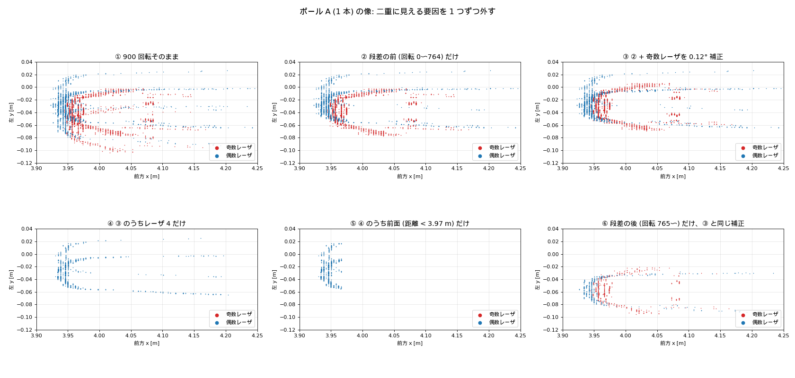
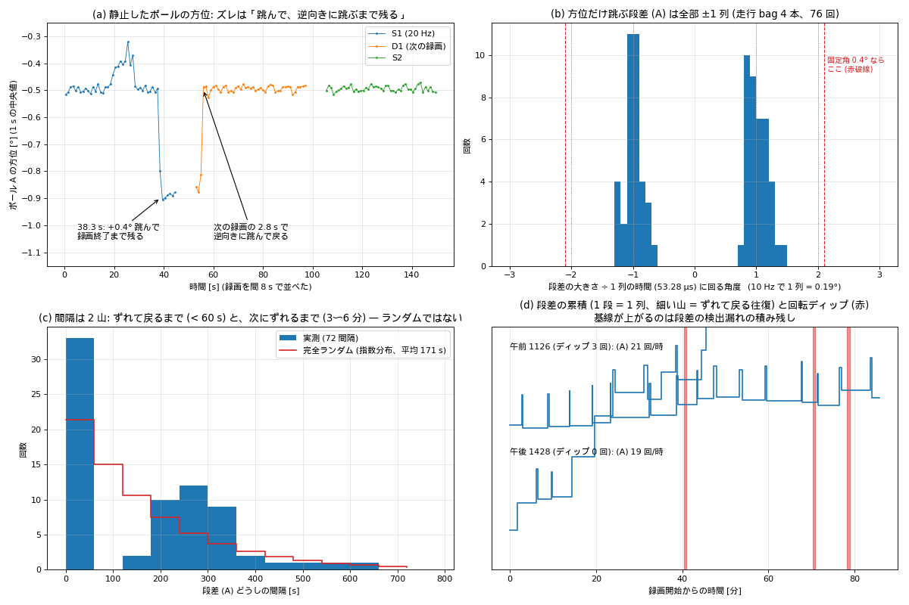
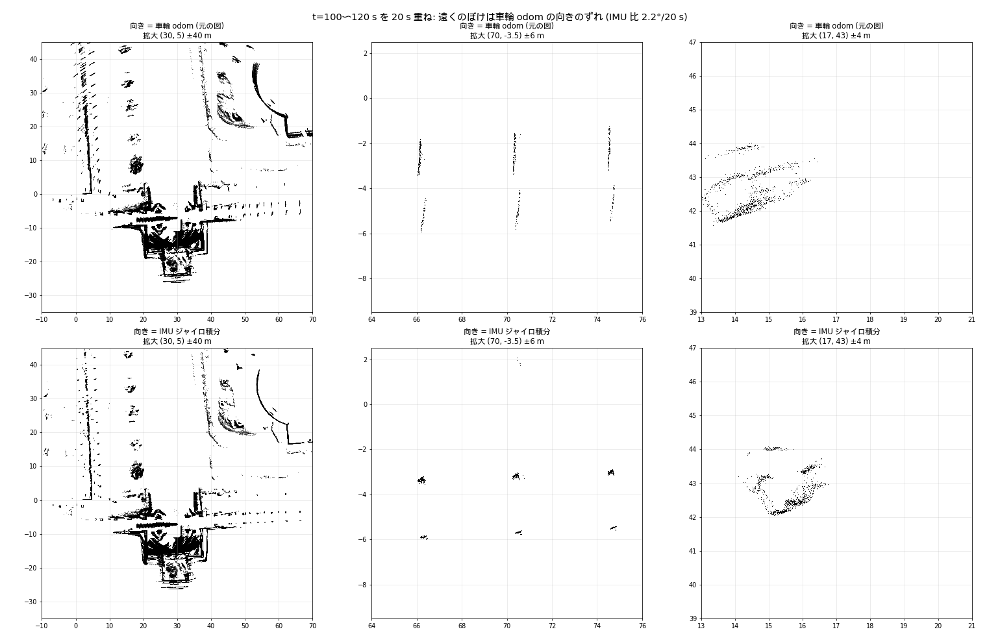

<!-- claude: 2026-10-28 作成 (10-27〜28 の調査をまとめた。原因特定はユーザ判断で保留) -->
# R-Fans の報告方位が 1 列ぶん跳ぶ — 静止ポールの二重像と、回転数で変わる方位

**ステータス: 保留 (原因未特定、2026-10-28 ユーザ判断)。観測は critic 査読済み (§2〜§3 の表現は critic の判定に合わせた)**。R-Fans-16 (0x5C) が報告する方位の値が、ときどき「1 列の発射間隔 (53.28 µs) に回る角度」だけ跳び、しばらくして逆向きに跳んで戻る。静止したポールを長時間重ねると二重に見える主因。回転ディップとの関連は検出されなかった。別件として、方位は回転数でも系統的に変わる (§3)。

- 発端: 櫛偽点のフィルタ比較図 ([2026-10-25_rfans_range_comb_ghost.md](2026-10-25_rfans_range_comb_ghost.md) §8.1) で、ユーザ「1 本の棒なのにポールの像がダブっている」「走行図が機体から離れるほどぼけている」
- データ: 静止 pcap `bags/rfans_check/2026-10-26/run2/` (C0〜C4)・`bags/rfans_check/2026-10-27/run_dual/` (S1/S2/D1/D2)。走行 bag の生パケット `/rfans_driver/rfans_packets` (10-03 つくば 1126 / 1428、10-22 新習志野 1622、10-22 5 号館 1825)
- スクリプト: `bags/rfans_check/2026-10-27/scripts/` (`pole_clean.py` / `pole_az_timeline.py` / `az_step_fig.py` / `moving_imu_yaw.py` ほか)、bag の走査 `bags/tools/2026-10-27_az_glitch/az_glitch_bag.py` (結果 `*.log` / `*.json`)
- 画像: `docs/issue/img/2026-10-27_rfans_azimuth_step/`

## 1. 何が起きているか

```
静止したポールを 900 回転重ねると二重に見える
├─ ❶ 報告方位の段差 (主因): 方位の値だけが 1 列ぶん跳び、逆向きに跳ぶまで残る
├─ ❷ 奇数/偶数レーザの 0.12° 差 (系統的): ドライバが 0x5C に 0x57 の水平角補正表 [6.01, 3.377] を流用
└─ ❸ 輪郭の混合画素の尾 (光学的): ポールの縁で奥へ伸びる C 字の尾
```

下の図は、ポール A 1 本の像から要因を 1 つずつ外したもの。② 段差の前だけにすると二重が消え、③ 奇数レーザを 0.12° 補正すると赤 (奇数) と青 (偶数) が重なる。⑥ 段差の後だけでも同じ形になる (位置だけ横にずれる)。



- 図を作る側の誤りも 1 つあった: 自前の pcap 変換に、ドライバと同じ発射時刻補正 (レーザごとの DELTA_T と、列 2 の +53.28 µs) が抜けていて、列どうしが 0.35° ずれていた。修正済み (`pcap_points.py`)。

## 2. 段差の性質 (観測)



### 2.1 2 種類の「方位の跳び」がある (critic 指摘で分離)

| 種類 | 方位 | パケットの GPS 時刻欄 | 物体の見かけ位置 | 例 |
|---|---|---|---|---|
| **(A) 方位だけ跳ぶ** | 1 列ぶん跳ぶ | 正常 (1278/1279 µs 刻み) | **動く** (二重像の原因) | S1 pkt 29918 +0.41°、D1 pkt 4353 −0.37° (20 Hz) |
| (B) 方位と時刻が一緒に跳ぶ | 1 グループぶん跳ぶ | 次のパケットで +106.5 µs (= 1 グループ) | 動かない (無害) | S1 15258、C1 3803、D1 42690 |
| ? | — | 重複・先走り (差 2558 → 0 など) | 判定不能 | C2 10833 |

- 判定: `az_glitch_bag.py` の `shift()`。「先頭グループの方位 − 局所回転速度 × GPS 時刻」の前後差を見る。上の手検査 5 件と一致を確認。
- 10-27 夜に出した「約 45 回/時」は (A)+(B)+? の合計で、(A) だけだと **18〜21 回/時** (5 号館 1825 は 66 回/時だがディップ中の停止を含む)。

### 2.2 (A) の大きさは 1 列の時間で決まる

- 10 Hz の走行 bag 4 本、76 回すべてが **±0.13〜0.26° (平均 ±0.19° = 1 列 53.28 µs × 3600 °/s)**。図 (b)。
- 20 Hz の静止 pcap では ±0.37〜0.41° (= 20 Hz の 1 列 0.384°)。
- 固定角 (エンコーダの刻み 0.4° 級) の取りこぼしなら 10 Hz でも 0.4° になるはずで、そうはなっていない → **時間 (発射の 1 コマ) 単位でずれている**と読める。ただし機構 (ファームの方位ラッチがコマ単位で滑る等) は未検証の仮説。

### 2.3 時間的な形: 「数分おきにずれて、1 分以内に戻る」

<!-- claude: 2026-10-28 10-27 夜にユーザへ「ランダム (ポアソン)、平均 1〜2 分に 1 回」と説明したのは (A)(B) 混在の集計による誤り。下が (A) だけの結果 -->

| bag | (A) | 往復 (ずれて戻る) | ずれている時間 | 往復の開始間隔 (中央値、CV) |
|---|---|---|---|---|
| 10-03 午前 1126 (86 分) | 30 | 15 (全部 + 側、対になり残り 0) | 3〜37 s | 334 s (CV 0.26) |
| 10-03 午後 1428 (57 分) | 18 | 6 | 11〜53 s | 447 s (CV 0.50) |
| 10-22 新習志野 1622 (64 分) | 19 | 7 | 0〜51 s | 538 s (CV 0.37) |
| 10-22 5 号館 1825 (18 分) | 9 | 4 | 1〜33 s | 174 s (CV 0.13) |

- 普段はずれていない状態にいて、**数分おきに + 側へ 1 列ずれ、数秒〜1 分弱で戻る**。間隔の分布は 2 山 (図 (c))。ランダム (指数分布) ではなく、準周期的。
- 対にならない単独の段差 (1428 で 6 個、1622 で 5 個) は、検出漏れ (パケット境界の跳びは数えていない、約 1/12) か「?」に入った相方と見ている (未確認)。
- 静止 pcap S1 の 38.3 s のずれは、録画を止めても次の録画 D1 の 2.8 s まで残った (図 (a))。録画の開始・停止ではリセットされない。

### 2.4 回転ディップとの関連は検出されなかった (検出力は低い)

- 10-03 午前 (ディップ 3 回) と午後 (0 回) で (A) の頻度はほぼ同じ (21 / 19 回/時)。
- ディップ直前 5 分の (A) は 2 / 2 / 2 個 (期待 約 1.75)、最後の (A) からディップまで 96〜171 s。
- ディップは 3 回しかないので、「無関係」とまでは言えない。ディップ自体の調査は [2026-09-02_rfans_scan_motor_dropout.md](2026-09-02_rfans_scan_motor_dropout.md)。

## 3. 方位は回転数でも変わる (別件、観測)

同じ電源投入・同じポール、発射時刻補正あり:

| 回転数 | ポール方位 | 再現 |
|---|---|---|
| 20 Hz | −2.91° | C0 / C2 とも同じ |
| 10 Hz | −3.10° | C1 −3.10 / C4 −3.11 (間に別の回転数を挟んでも戻る) |
| 5 Hz | −3.24° | C3 |

- 20→10 Hz の差 0.19° は 52.8 µs 相当で、1 列 (53.28 µs) とほぼ同じ。10→5 Hz の差は 78 µs 相当で、一定の時間ずれの直線には乗らない。
- 原因候補 (未識別): センサ側の時刻基準のずれ / **こちらの発射時刻補正の規約 (列の基準) が 1 列ずれている** / 5 Hz の方位補間の癖 (~~5 Hz では方位差 14 (通常 19) が多発~~ → **10-29 訂正: 方位差 14 は録画冒頭 0.3 s (回転の整定中) の 122 件だけで、以後 0 件。5 Hz の通常値も 19 固定ではなく 18〜20 の混合 (平均 19.16)**)。
- 実用上の注意: `rfans_joint` の yaw +0.098 rad の校正 ([closed/2026-10-16_amcl_lateral_bias_rfans_yaw_offset.md](closed/2026-10-16_amcl_lateral_bias_rfans_yaw_offset.md) の 10-16 実験) は **10 Hz で測った値**。回転数を変えるなら測り直す。

## 4. 走行図の遠方のぼけは車輪 odom の向き (LiDAR ではない、critic: 支持)

- `moving_100.png` (新習志野 10-22、t = 100〜120 s を車輪 odom `/odom` で重ねた図) は、機体から離れるほど回転方向にぼけていた。
- 直進中、車輪 odom の向きは 0 °/s のまま、IMU (BNO086 ジャイロ積分) は −0.1 °/s。20 s で 2.2° ずれ、70 m 先の柱が 1.5〜1.9 m の筋になる。
- 向きだけを IMU に替えて重ね直すと、柱は約 0.2 m の塊にまとまる (下段)。点ごとの時刻で姿勢を補間しても、旋回中の回転を除いても変わらない (`moving_blur.py`)。
- 残る約 0.2 m (70 m 先で約 0.16°) には、§2 の段差や奇偶差が混ざっている可能性がある。



## 5. 影響の見積もり

- (A) 1 回のずれは 10 Hz で 0.19° = 20 m 先で横 7 cm。ずれている時間は全体の 1 割前後。
- 1 フレーム内で完結する処理 (AMCL、櫛フィルタ) への影響は小さい見込み。効くのは長時間の重ね描き・静止での精密な方位計測 (取付角の校正など)。

## 6. 棄却できていない代替仮説

1. **(A) もデコード・記録の副作用**: デュアルの偶奇対・0/36000 の折り返し・パケット欠落は critic が確認して否定的。ただしドライバを通さない別のキャプチャ (tcpdump) との突き合わせはしていない。
2. **準周期 (数分おき) の由来**: 温度・電源・内部タイマーなど。測っていない。
3. **§3 の回転数依存が §2 と同じ仕組みか**: どちらも「1 列ぶん」に近いが、10→5 Hz が合わない。

## 7. 再開するときの次の一手 (保留中)

1. 5 Hz で 10 分の静止 pcap を 1 本: 時刻コマ説なら (A) は 0.096°、固定角説なら 0.4°。
2. 10 Hz で 30 分の静止 pcap: 往復の周期と、ずれている時間の分布を (A) だけで確かめる (走行の振動を除く)。
3. メーカー (SureStar) への問い合わせ材料: §2.1 の表と図 (b)・(d)、§3 の表。

## 8. 追記 (2026-10-29、静止 pcap の再走査、critic 査読済み)

<!-- claude: 2026-10-29 追記 (櫛偽点の再調査と同時に実施) -->

- 10-26/27 の静止 pcap 9 本を `az_glitch_all.py` で再走査した。(A) 型 (方位だけ 1 列跳ぶ) は S1 (+0.41°) と D1 (−0.36°) の 2 件のみ (既知)。**5 Hz の C3 (45 s) には (A) が 0 件** — 期待値 約 0.25 件なので「時刻コマ説 (0.096°) か固定角説 (0.4°) か」は判定不能のまま。§7-1 の「5 Hz で 10 分」が必要なことを再確認した。
- §3 の「5 Hz では方位差 14 が多発」は誤りだった (上の訂正)。したがって 5 Hz のポール方位 −3.24° は整定後のデータで決まっており、10→5 Hz の差 (0.14°) が 1 列時間の直線 (0.096°) に乗らない問題は残る。
- **1 パケット欠落** (GPS 時刻差 2 パケット分 + 方位 1 パケット分跳ぶ) が静止 pcap に数回/45 s あり (C1: 3、C2: 4、C3: 2、S2: 2、D1: 2〜3、D2: 5、C0・C4・S1: 0)、critic が bag の packets でも同率を確認 (10-22 新習志野 7.9/45 s、10-03 つくば 0.1/45 s) → 録画スクリプト固有ではない。詳細と切り分け手順は [2026-10-25_rfans_range_comb_ghost.md](2026-10-25_rfans_range_comb_ghost.md) §9.6。(A) の集計 (§2.3) はこの穴をパケット境界として除外しているので影響しない。
