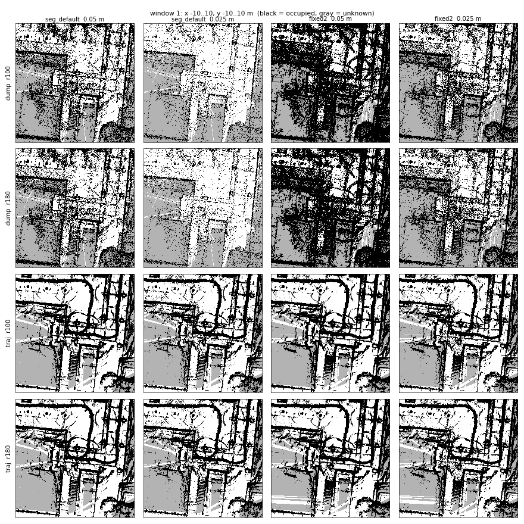
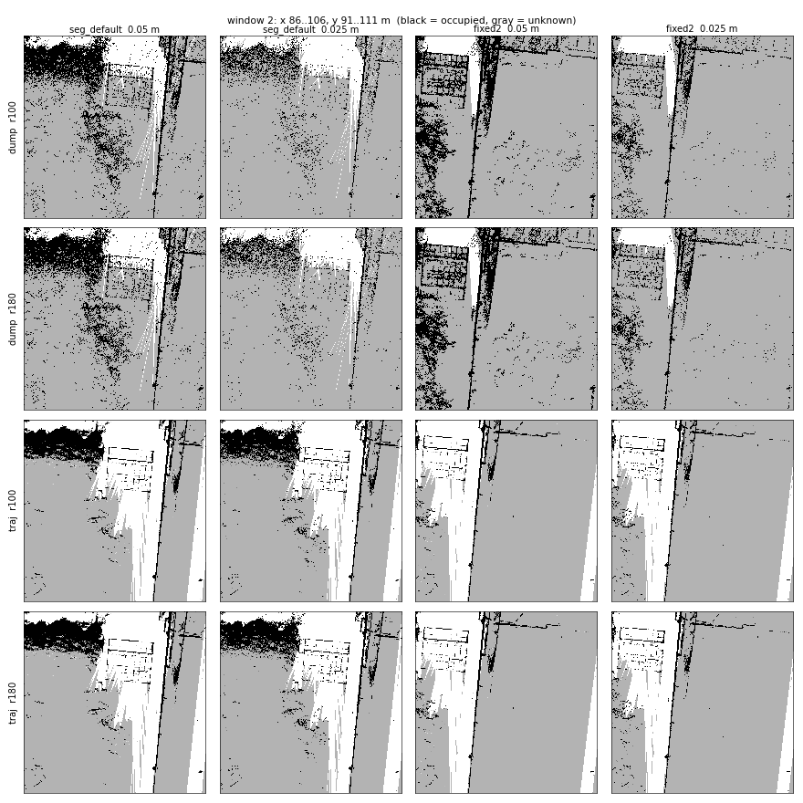
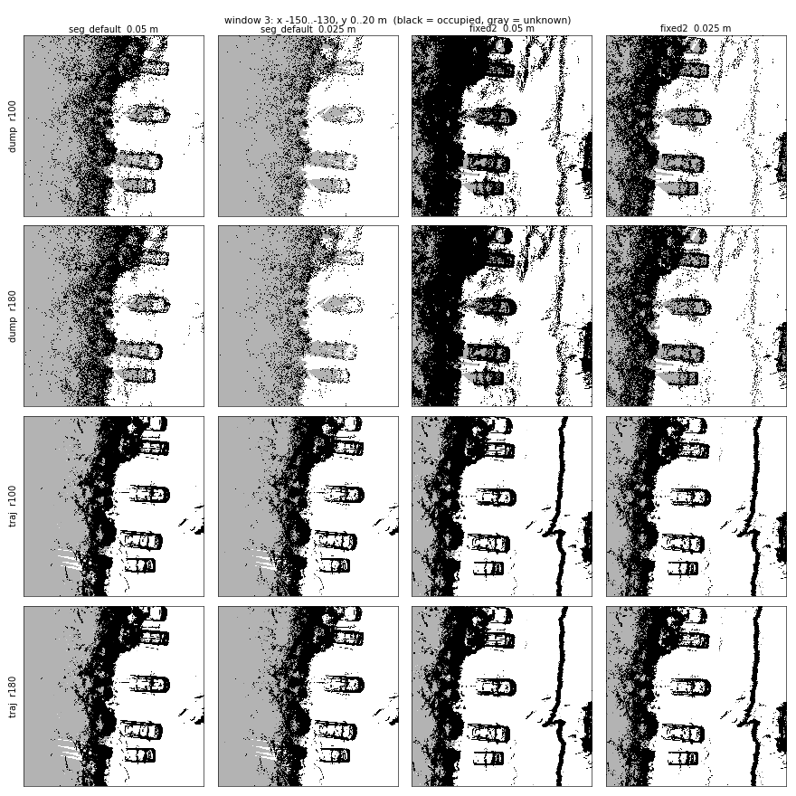
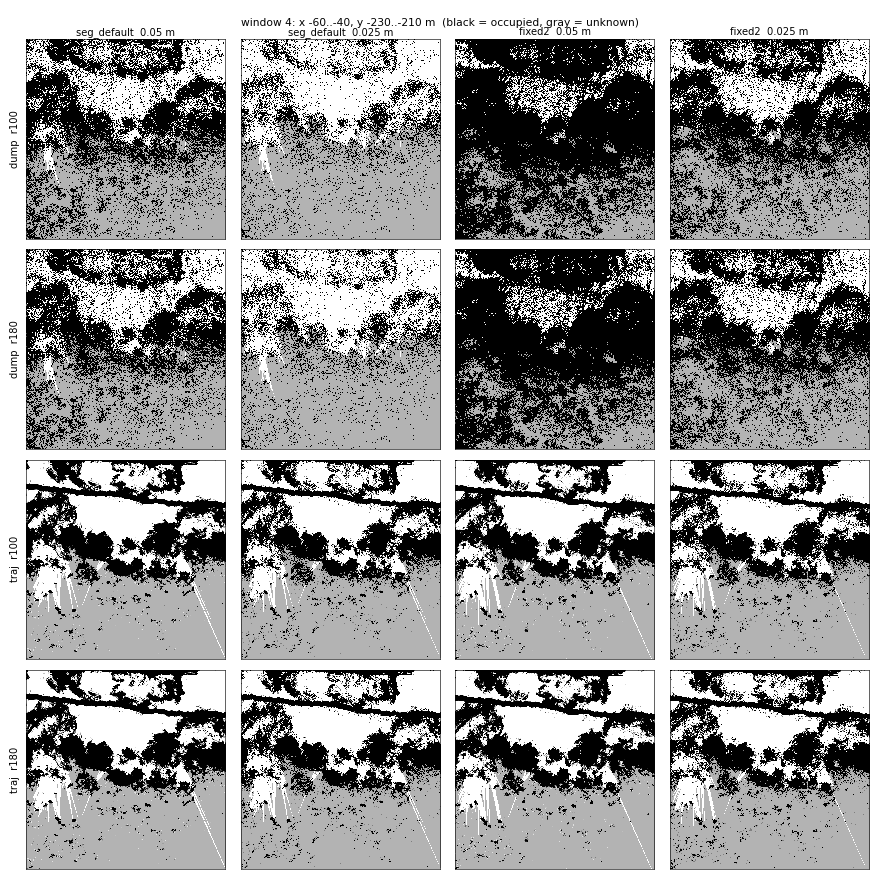
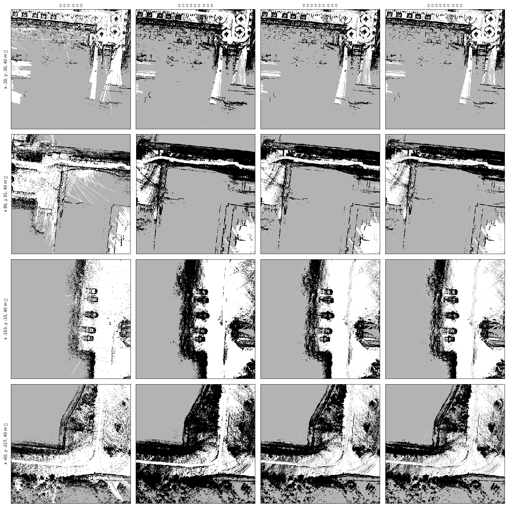

<!-- claude: 2026-10-29 作成 (新習志野 10-22 1622 の自己位置推定用地図を 16 通り作って見た目で比較。AMCL での評価は未実施) -->
# 新習志野の自己位置推定用地図 — dump / traj × 100 / 180 m × 0.05 / 0.025 m × seg_default / fixed2 の比較

**ステータス: 見た目の比較のみ (AMCL での精度・起動負荷は未評価)**。新習志野チャレンジ (10-22 1622) の GLIM 結果 2 本から、AMCL 用地図を 16 通り作って同じ場所を並べた。**traj 版は 0.05 m でも 0.025 m でも輪郭がくっきりし、dump 版はどの解像度でも点々になる**。100 m と 180 m は軌跡の近くでは同じ地図になる。同日、nav2/keep_out を帯を取り違えて作っていたのが見つかり、作り直した (§5)。

- 地図: `maps/2d/glim/2026-10-22_1622_shinnarachallenge_{seg_default_all,fixed2_all}/` (別リポジトリ `maps/2d` = reRoBot-2Dmaps)
- 生成スクリプト: `bags/tools/make_maps_2026-10-29_r0025/` (`make.sh` = traj r180 0.025 / `make_dump.sh` = dump 0.025 / `make_rest.sh` = 残り) と `bags/tools/make_maps_2026-10-28/make_maps.sh` (元の一式)
- 比較スクリプト: `bags/tools/make_maps_2026-10-29_r0025/compare_all.py`
- 画像: `docs/issue/img/2026-10-29_shinnara_loc_map_compare/`

## 1. 比べた 16 枚

```
自己位置推定用地図 (高さ 0.3〜100 m、base_link 基準。AMCL の /rfans/scan_all と同じ帯)
├─ 元データ
│   ├─ dump : GLIM が出力した点群 (サブマップ) を 2D に落とす   raw_dump/
│   └─ traj : bag の生の点を GLIM の軌跡で並べ直す (deskew あり)  raw_traj/
├─ 距離    : 各スキャン位置から 100 m / 180 m 以内の点だけ使う    0.3-100.0_r100 / _r180
├─ 解像度  : 0.05 m / 0.025 m
└─ GLIM 結果: seg_default_all / fixed2_all
```

| 元 | 解像度 | ファイル | 黒にする点数 (灰〜黒) | 範囲 |
|---|---|---|---|---|
| dump | 0.05 m | `raw_dump/<帯>/map_r005.yaml` | 0〜1 (1 点で黒、下限) | world 中心 342 × 595 m |
| dump | 0.025 m | `raw_dump/<帯>/map_r0025.yaml` | 0〜1 | 同上 |
| traj | 0.05 m | `raw_traj/<帯>/map.yaml` (10-28 作成、従来の AMCL 用) | 12〜20 | 軌跡 + 距離 (r180 で 650 × 900 m) |
| traj | 0.025 m | `raw_traj/<帯>/map_r0025.yaml` | 3〜5 (= 0.05 m の 1/4) | 軌跡の範囲 + 30 m (342 × 542 m) |

- dump の 0.10 m 版 (`raw_dump/<帯>/map.yaml`、閾値 0〜2) は 10-28 からある。
- traj の 0.025 m は全範囲だと 9.4 億画素になり、生成に約 7 GB、AMCL の尤度場に約 15 GB 要る見積もりなので、軌跡の範囲 + 30 m に切った。それでも 3 億画素 (pgm 約 300 MB) で、0.05 m の r180 (2.3 億画素) の 1.3 倍。
- 0.025 m の pgm は GitHub の 100 MB 上限を超えるので `maps/2d/.gitignore` で除外 (yaml と params は追跡)。

## 2. 結果: 黒の割合

16 枚とも見えている (unknown でない) 範囲 19,765 m² で、0.5 m 単位の格子に揃えて数えた。

| 元 | 距離 | seg_default 0.05 | seg_default 0.025 | fixed2 0.05 | fixed2 0.025 |
|---|---|---|---|---|---|
| dump | r100 | 24.0% | **11.6%** | **38.7%** | 26.5% |
| dump | r180 | 24.0% | 11.6% | 38.8% | 26.6% |
| traj | r100 | 25.0% | 25.5% | 26.7% | 27.1% |
| traj | r180 | 25.1% | 25.5% | 26.7% | 27.1% |

- traj は 4 列とも 25〜27% でそろう。解像度を変えても黒の割合がほとんど変わらない。
- dump は解像度と GLIM 結果で 11.6〜38.8% とばらつく。seg_default の 0.025 m は黒が traj の半分以下、fixed2 の 0.05 m は 1.5 倍。
- r100 と r180 は 0.1 ポイント以内で同じ。

## 3. 結果: 見た目 (4 か所、20 m 四方)

行 = 元データ × 距離、列 = GLIM 結果 × 解像度。黒 = 障害物、灰 = 見えていない、白 = 空き。

### 窓 1: 原点付近 (建物の入口・植栽の円・階段)



### 窓 2: 北東 (植え込みと柵)



### 窓 3: 西 (駐車中の車と植え込みの縁)



### 窓 4: 南 (木の並び)



読み取れること:

```
見た目の比較
├─ traj (下 2 行)
│   ├─ 手すり・植栽の円・車・木の輪郭が線でくっきり出る
│   └─ 0.05 m と 0.025 m の差は線が少し細くなる程度 (黒の割合も ±0.5 ポイント)
├─ dump (上 2 行)
│   ├─ どの解像度でも砂粒状。輪郭が点の集まりでしか出ない
│   ├─ seg_default 0.025 m は車・柵がほぼ消える (窓 2・窓 3)
│   └─ fixed2 0.05 m は植え込み・木が黒く塗りつぶされる (窓 1・窓 4)
├─ 100 m と 180 m (1・2 行目、3・4 行目) → 4 か所とも見分けがつかない
└─ seg_default と fixed2 (左 2 列と右 2 列)
    └─ traj 同士でも中身に差がある: 窓 2 の左上の植え込みは seg_default だけ、
       窓 3 右側の縦の線 (塀か縁石) は fixed2 だけに出る
```

## 4. 解釈 (見立て、未検証のものを含む)

- **dump が点々になる理由**: dump は GLIM がサブマップ用に間引いた点群で、帯内の点は seg_default が 1,545 万点、fixed2 が 9,110 万点しかない。traj は bag の全スキャンを使うので、帯内の点は 6.6 億点ある。0.05 m 以下のマスを埋めるには点が足りない (見立て。GLIM 側の間引き設定は確かめていない)。dump の濃さは「どれだけ間引かれたか」で決まり、GLIM の設定で seg_default と fixed2 が 6 倍違う。
- **100 m と 180 m が同じ理由**: 比べた範囲は軌跡の近く (軌跡の範囲 + 30 m 以内) だけ。この範囲の物は、たいてい 100 m 以内のどこかのスキャン位置から見えているので、180 m に広げても点が増えない。差が出るのは、軌跡から 100 m 以上離れた遠くの建物などで、traj の r180 の地図はその分だけ外側に広い。
- **seg_default と fixed2 の差 (§3 最後)**: 同じ bag の点を別の軌跡で並べたものなので、見える物の違いは軌跡 (= GLIM の最適化結果) の違いのはず。ただし、2 つの地図の座標系が遠方でずれていて、同じ座標が別の場所を指しているだけの可能性もある (確かめていない)。

## 5. 同日の修正: nav2/keep_out が帯を取り違えていた

- 10-28 の `make_maps.sh` は、nav2/keep_out を AMCL 用と同じ **0.3〜100 m・180 m** で作っていた。従来 (tsukuba_composite・5goukan_chal など) は **0.2〜1.7 m・30 m**。頭より上の枝や庇まで、経路計画の障害物になっていた。
- 2 本とも 0.2〜1.7 m・30 m で作り直した (元にした地図は `raw_dump/0.2-1.7`、旧版は `bags/tools/2026-10-29_nav2_band/backup/`)。
- 閾値: fixed2 は帯内の点が seg_default の 6.8 倍あるので、同じ 0〜2 点だと黒が 52.6% になって潰れる。0〜6 点 (3 点以上で黒) にして 35.2% とし、seg_default の 36.8% に揃えた (下図: 左から seg 0-2 / fixed2 0-2 / fixed2 0-5 / fixed2 0-6)。



- ついでに `tools/glim_dump_to_2dmap/glim_dump_to_2dmap.py` を省メモリ化した。fixed2 の dump を 0.025 m で作ると 2 回 OOM になったため、全点 xy と濃度変換を float32・in-place にした。既存の 0.10 m 地図との差は 5〜7 画素。

## 6. 次の一手

1. **bag 再生で AMCL を比べる**: traj 0.05 m と 0.025 m の地図で、横ずれ・起動時の尤度場作成時間・メモリを測る。AMCL は起動条件に鋭敏なので、反復して評価する (メモリ `amcl-replay-pitfalls`)。見た目の差が小さいので、0.025 m の利点は実測しないと分からない。
2. **auto_run で別の yaml を選べるようにする**: 今は `raw_traj/<loc_band>/map.yaml` を決め打ちで読むので、`map_r0025.yaml` は `loc_map_yaml:=` を直接指定しないと使えない。
3. **seg_default と fixed2 の座標系のずれを確かめる** (§4 の最後)。
4. 不要になったら消すもの: dump の 0.05 / 0.025 m 版 (比較用)、`fixed2_all/raw_dump/0.3-100.0_r180_hi4/` (0.3〜100 m 帯で nav2 を作っていた途中の版)。
