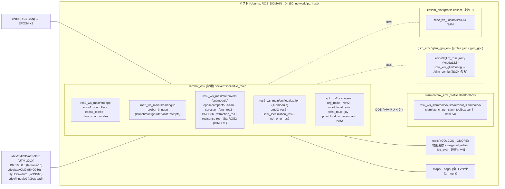
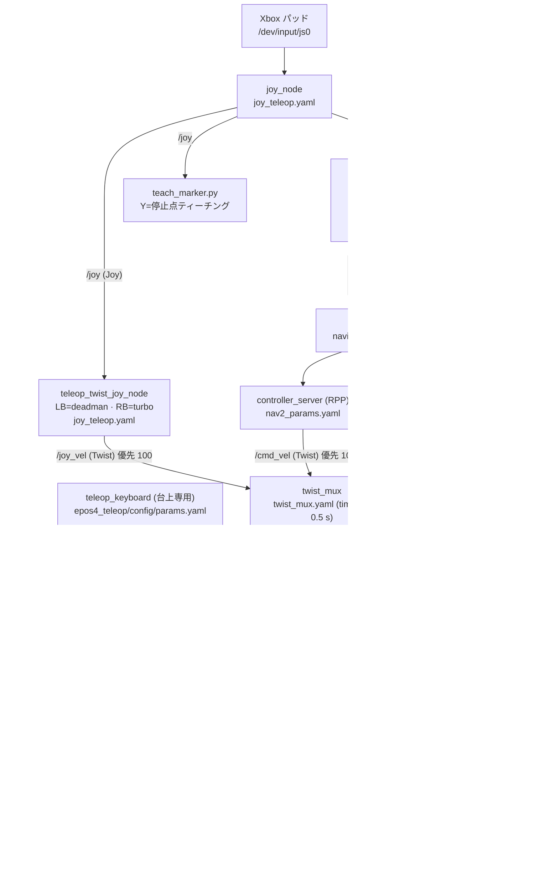
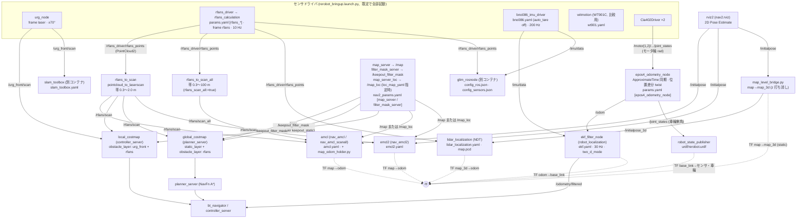
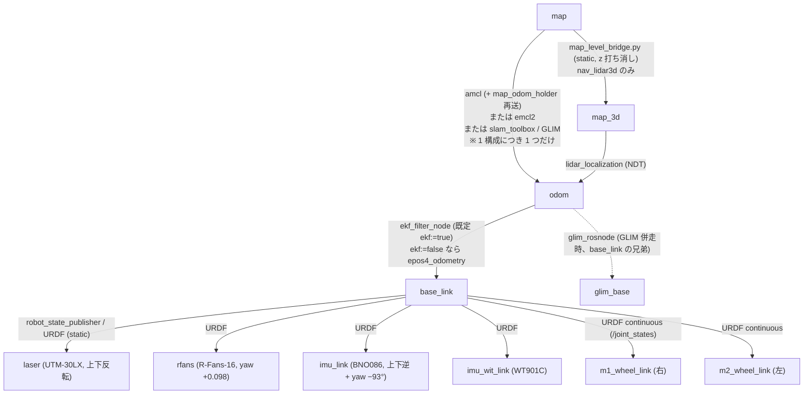
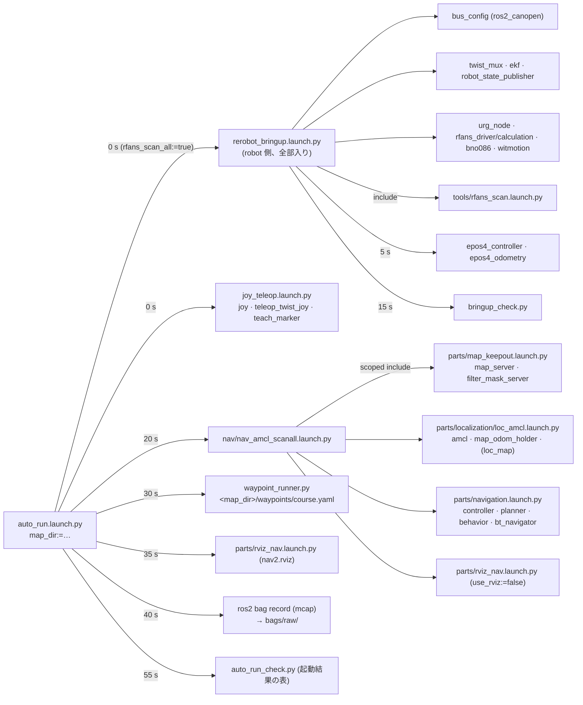

<!-- claude: 運用手引き 第16章 (2026-10-23 作成、ユーザ依頼「ソフトウェア構成図を mermaid で、パラメータファイルへのリンク付きで」)。
     事実は launch / config / ソースから引いた (調査時点 main 3f0c8f9)。推測で描いた箇所はない。
     構成が変わったら図と表を同時に直す。パスのリンクは docs/manual/ 基準の相対パス。 -->

# 第16章 ソフトウェア構成図

本章は「何がどこで動いて、何を出し入れし、どのファイルで値が決まるか」を図と表で一望する章。
手順は各章 (起動 = [第4章](04_startup_teleop.md) / launch の選び方 = [第15章](15_launch_guide.md) / パラメータの意味 = [第3章](03_parameters.md))、仕組みの理解は `docs/text/` を参照。
以下 `B/` = `ros2_ws_main/src/bringup/rerobot_bringup/` の略。

## 16.1 コンテナと workspace

| コンテナ | 役割 | ビルド | 起動スクリプト | 定義 |
|---|---|---|---|---|
| `rerobot_env` | CAN モータ制御 + 全センサ + odometry/EKF + Nav2 + teleop + 自己位置推定 (2D/3D) | `./scripts/build.sh main` | [bringup2d.sh](../../scripts/bringup2d.sh) / [bringup3d.sh](../../scripts/bringup3d.sh) / [nav2d.sh](../../scripts/nav2d.sh) / [teleop.sh](../../scripts/teleop.sh)、本番は `auto_run.launch.py` 直叩き | [docker-compose.yml](../../docker-compose.yml) `main`、[Dockerfile_main](../../docker/Dockerfile_main) |
| `slamtoolbox_env` | 2D 地図作成 | `./scripts/build.sh slamtoolbox` | [slam2d.sh](../../scripts/slam2d.sh) | [Dockerfile_slamtoolbox](../../docker/Dockerfile_slamtoolbox) |
| `glim_env` / `glim_gpu_env` | 3D SLAM (GLIM)。GPU 版は `config.gpu.json` を `/glim_config/config.json` に被せるだけ | イメージのみ (`build.sh images` / `glim_gpu`) | [glim3d.sh](../../scripts/glim3d.sh) | [Dockerfile_glim](../../docker/Dockerfile_glim)、[ros2_ws_glim/config/](../../ros2_ws_glim/config) |
| `liosam_env` | LIO-SAM (IMU 再入手まで凍結) | `./scripts/build.sh liosam` | — | [Dockerfile_liosam](../../docker/Dockerfile_liosam) |

## 16.2 指令系 — 操作入力からモータまで

速度指令の経路は **1 本** (twist_mux が唯一の `/robot_speed_cmd` publisher)。例外はキーボード teleop の直書きだけ。

| 値を決めるファイル | 主なキー | 読むノード |
|---|---|---|
| [config/twist_mux.yaml](../../ros2_ws_main/src/bringup/rerobot_bringup/config/twist_mux.yaml) | `/joy_vel` priority 100 / `/cmd_vel` priority 10、timeout 0.5 s | twist_mux |
| [config/joy_teleop.yaml](../../ros2_ws_main/src/bringup/rerobot_bringup/config/joy_teleop.yaml) | `scale_linear[_turbo].x` 0.5/0.8、`enable_button` 4 (LB)、`enable_turbo_button` 5 (RB)、`teach_marker.button` 3 (Y)、`waypoint_runner.start_button` 7 / `pause_button` 6 | joy_node · teleop_twist_joy · teach_marker · waypoint_runner |
| [config/params.yaml](../../ros2_ws_main/src/bringup/rerobot_bringup/config/params.yaml) | `tread_width` 0.529 · `tire_diam` 0.256 · `gear_ratio` 92.25 · `invert_*` · `max_motor_accel/decel_rpm_per_s` 15000 · `cmd_timeout_s` 0.5 · `link_loss_timeout_s` 1.0 | epos4_controller · epos4_odometry |
| [epos4_teleop/config/params.yaml](../../ros2_ws_main/src/app/epos4_teleop/config/params.yaml) | 車体値の**手動コピー** + `max_linear` 1.0 / `max_angular` 2.0 | teleop_keyboard (`/params-sync` で整合検査) |
| [bus.yml](../../ros2_ws_main/src/drivers/epos4compact50-5can/maxon_epos4_ros2/config/bus_config_cia402_epos4_vel/bus.yml) (submodule) | `scale_pos_from_dev` 2π/1024 · `period` 50 ms · `sync_period` 10 ms · TPDO = {0x6041, 0x6064, 0x6061} (0x606C 速度は未マップ → `joint_states.velocity` 常 0) | Cia402Driver |
| [behavior_trees/navigate_through_poses_follow.xml](../../ros2_ws_main/src/bringup/rerobot_bringup/behavior_trees/navigate_through_poses_follow.xml) | 計画失敗時に旧経路を保持、連続失敗 20 回で諦め、リカバリは Clear + Wait のみ | bt_navigator (NavigateThroughPoses のみ) |
| [config/nav2_params.yaml](../../ros2_ws_main/src/bringup/rerobot_bringup/config/nav2_params.yaml) | `desired_linear_vel` 0.4 · `failure_tolerance` −1 · `max_allowed_time_to_collision_up_to_carrot` 2.0 · footprint 実寸四角 · costmap plugins | controller / planner / behavior / bt_navigator / map_server |

## 16.3 センサ系 — センサから自己位置推定・Nav2 まで

| 値を決めるファイル | 主なキー | 読むノード | 詳細章 |
|---|---|---|---|
| [config/params.yaml](../../ros2_ws_main/src/bringup/rerobot_bringup/config/params.yaml) `rfans_driver` / `rfans_calculation` | `device_ip` 192.168.0.3 · `rps` 10 (2 節で同値必須) · `frame_id` rfans · `vangle_override` (16 リング実測縦角) · `rps_watchdog` | surestar_rfans_ros2 | [第3章](03_parameters.md) |
| [config/bno086.yaml](../../ros2_ws_main/src/bringup/rerobot_bringup/config/bno086.yaml) | `auto_tare: off` (⚠ 既定 all だと accel/gyro が回る) · `publish_tf false` · `imu_rate_hz` (launch が 200 で上書き) | bno086_imu_driver | [issue 09-24](../issue/2026-09-24_bno086_auto_tare_rotates_motion_outputs.md) |
| [config/wt901.yaml](../../ros2_ws_main/src/bringup/rerobot_bringup/config/wt901.yaml) | `port ttyUSB-wt901` · `/imu_wit/data` · frame `imu_wit_link` | witmotion_ros | [features 09-23](../features/2026-09-23_wt901c_comparison_imu.md) |
| [config/ekf.yaml](../../ros2_ws_main/src/bringup/rerobot_bringup/config/ekf.yaml) | `odom0` = vx, vy, vyaw のみ · `imu0` = yaw, vyaw のみ · `imu0_relative true` · `publish_tf true` | ekf_filter_node | [第3章 3.3](03_parameters.md)、[text/ekf_fusion](../text/ekf_fusion/00_index.md) |
| [urdf/rerobot.urdf](../../ros2_ws_main/src/bringup/rerobot_bringup/urdf/rerobot.urdf) (= `.flat.urdf`) | laser (0.067, 0, 0.094, roll π, yaw +0.010) · rfans (0, 0, 0.794, yaw +0.098) · imu_link (0, 0, 0.733, rpy π, 0, −1.6257) · imu_wit_link · 車輪 r 0.128 / y ±0.2645 | robot_state_publisher | [features 10-16 yaw 較正](../features/2026-10-16_rfans_yaw_calib.md) |
| [launch/tools/rfans_scan.launch.py](../../ros2_ws_main/src/bringup/rerobot_bringup/launch/tools/rfans_scan.launch.py) (bringup から include) | `/rfans/scan` 帯 0.3〜2.0 m · `/rfans/scan_all` 帯 `scan_all_min/max_height` (地図の帯と揃える) | pointcloud_to_laserscan | [第14章](14_pointcloud_to_laserscan.md) |
| [config/localization/amcl.yaml](../../ros2_ws_main/src/bringup/rerobot_bringup/config/localization/amcl.yaml) | `alpha1〜4` 0.02 · `transform_tolerance` 2.0 · `laser_max_range` 100 · `max_beams` (launch 上書き 60 / 2000) · `scan_topic` (launch 上書き) | amcl | [第11章](11_amcl.md)、[issue 10-11](../issue/2026-10-11_loc_eval_2d_corner_loss_vs_3d.md) |
| [config/localization/emcl2.yaml](../../ros2_ws_main/src/bringup/rerobot_bringup/config/localization/emcl2.yaml) | `num_particles` 500 · `alpha_threshold` 0.5 · `transform_tolerance` 0.2 | emcl2 | 比較用 (未チューニング) |
| [config/localization/lidar_localization.yaml](../../ros2_ws_main/src/bringup/rerobot_bringup/config/localization/lidar_localization.yaml) | `global_frame_id map_3d` · `ndt_resolution` 2.0 · `voxel_leaf_size` 0.3 · `use_odom_tf_prediction` · `map_odom_tf_future_dating_sec` 0.5 | lidar_localization | [features 10-10](../features/2026-10-10_lidar_localization_3d.md) |
| [config/nav2_params.yaml](../../ros2_ws_main/src/bringup/rerobot_bringup/config/nav2_params.yaml) | local: plugins `[keepout_static, obstacle_layer, inflation_layer]`, `observation_sources urg_front rfans` / global: `[static_layer, keepout_static, obstacle_layer, inflation_layer]`, `observation_sources rfans` · `inflation_radius` 0.55 · `obstacle_max_range` | controller_server · planner_server | [第10章](10_nav2.md) |
| [slam_toolbox.yaml](../../ros2_ws_slamtoolbox/src/rerobot_slamtoolbox/config/slam_toolbox.yaml) | `scan_topic /urg_front/scan` · `resolution` 0.05 · `scan_queue_size` 10 (意図的) | slam_toolbox | [第6章](06_slam_toolbox.md)、[text/slam_toolbox](../text/slam_toolbox/00_index.md) |
| [ros2_ws_glim/config/](../../ros2_ws_glim/config) — [config.json](../../ros2_ws_glim/config/config.json) (入口) · [config_ros.json](../../ros2_ws_glim/config/config_ros.json) · [config_sensors.json](../../ros2_ws_glim/config/config_sensors.json) · [config_preprocess.json](../../ros2_ws_glim/config/config_preprocess.json) | `points_topic /rfans_driver/rfans_points` · `imu_topic /imu/data` · `base_frame_id glim_base` · `acc_scale 0.0` · `T_lidar_imu` (URDF と**セットで**更新) · `k_correspondences` 20 | glim_rosnode | [第7章](07_glim.md)、[text/glim](../text/glim/00_index.md) |

## 16.4 TF ツリー

- `base_footprint` は無い。Nav2 の `robot_base_frame` はすべて `base_link`。
- `map→odom` を 2 つの部品が同時に出すと TF が跳ぶ。nav 側 launch は **1 本だけ**起動する ([第15章 15.7](15_launch_guide.md))。
- GLIM は `base_frame_id: glim_base` にして車輪 odom の `odom→base_link` と衝突させない ([config_ros.json](../../ros2_ws_glim/config/config_ros.json))。

## 16.5 トピックのツリー

配信 (P) と購読 (S) の主なノード。型と根拠行は各ノードの launch / ソースを参照。

| 名前 | 説明 |
|---|---|
| **駆動系** | |
| ├─ `/motor1/cia402_device_1/` (右輪) | ns は [bus.yml](../../ros2_ws_main/src/drivers/epos4compact50-5can/maxon_epos4_ros2/config/bus_config_cia402_epos4_vel/bus.yml) |
| │　├─ `tpdo` | COData 0x60FF 目標速度 [rpm]。P: epos4_controller / S: Cia402Driver |
| │　├─ `rpdo` | COData 0x6041/0x6064/0x6061。P: Cia402Driver / S: epos4_controller (statusword・リンク監視) |
| │　├─ `joint_states` | JointState (position = モータ軸 rad、velocity は常に 0)。P: Cia402Driver / S: epos4_odometry · teleop_keyboard · bringup_check |
| │　└─ `init` `enable` `cyclic_velocity_mode` `recover` `sdo_read` … | サービス。C: epos4_controller (起動時) · bringup_check (sdo_read) |
| ├─ `/motor2/cia402_device_2/` (左輪) | 同上 |
| ├─ `/robot_speed_cmd` | Twist。P: **twist_mux** (teleop_keyboard は直書き) / S: epos4_controller |
| ├─ `/joy_vel` → `/cmd_vel` | Twist。P: teleop_twist_joy / controller_server・behavior_server / S: twist_mux (優先 100 / 10) |
| ├─ `/joy` | Joy。P: joy_node / S: teleop_twist_joy · waypoint_runner · teach_marker |
| ├─ `/robot_free_mode` | Bool。P: teleop_keyboard / S: epos4_controller (脱力) |
| └─ `/diagnostics` | DiagnosticArray。P: epos4_controller (Fault コード) · bno086_imu_driver |
| **センサ系** | |
| ├─ `/urg_front/scan` | LaserScan (frame laser)。P: urg_node / S: local_costmap · slam_toolbox · (AMCL は slam_toolbox 地図のとき) |
| ├─ `/rfans_driver/` | |
| │　├─ `rfans_packets` | 生 UDP パケット。P: rfans_driver / S: rfans_calculation (bag に残すと再計算できる) |
| │　└─ `rfans_points` | PointCloud2 (frame rfans, 10 Hz)。P: rfans_calculation / S: rfans_to_scan{,_all} · lidar_localization · glim_rosnode |
| ├─ `/rfans/` | ⚠ 裸の `/scan` は誰も出さない規約 (2026-10-08) |
| │　├─ `scan` | LaserScan 帯 0.3〜2.0 m。P: rfans_to_scan / S: costmap ×2 · amcl · emcl2 |
| │　├─ `scan_all` | LaserScan 帯 0.3〜100 m、全点。P: rfans_to_scan_all (`rfans_scan_all:=true`) / S: amcl (nav_amcl_scanall) |
| │　└─ `scan_far` | 既定では起動しない (farthest モード) |
| ├─ `/imu/data` (`/imu/mag`) | Imu (frame imu_link, 200 Hz)。P: bno086_imu_driver / S: ekf · glim_rosnode |
| └─ `/imu_wit/data` (`mag` `temperature`) | Imu (frame imu_wit_link)。P: witmotion / S: 比較・bag のみ |
| **推定系** | |
| ├─ `/odom` | Odometry (twist は位置差分)。P: epos4_odometry / S: ekf · teach_marker |
| ├─ `/odometry/filtered` | Odometry。P: ekf_filter_node / S: bt_navigator · controller_server |
| ├─ `/joint_states` | JointState (車輪側角)。P: epos4_odometry / S: robot_state_publisher |
| ├─ `/initialpose` → `/initialpose_3d` | PoseWithCovarianceStamped。P: rviz2 · initialpose.py / S: amcl · emcl2 · map_level_bridge (→ `_3d` → lidar_localization) |
| ├─ `/amcl_pose` `/particle_cloud` | amcl 出力 (ParticleCloud 型 — RViz は `nav2_rviz_plugins/ParticleCloud` で表示) |
| ├─ `/mcl_pose` `/particlecloud` `/alpha` | emcl2 出力 |
| └─ `/pcl_pose` `/path` `/alignment_status` … | lidar_localization 出力 |
| **地図・計画系** | |
| ├─ `/map` | OccupancyGrid (経路計画用)。P: map_server / S: planner (static_layer) · amcl/emcl2 (loc_map 無指定時) |
| ├─ `/map_loc` | OccupancyGrid (照合専用、`loc_map_yaml` 指定時)。P: map_server_loc / S: amcl · emcl2 |
| ├─ `/keepout_filter_mask` | OccupancyGrid。P: filter_mask_server / S: costmap ×2 の StaticLayer `keepout_static` (KeepoutFilter は 10-16 に廃止) |
| ├─ `/plan` `/local_plan` `/lookahead_point` | planner / controller の出力 (RViz · bag) |
| ├─ `/global_costmap/costmap` `/local_costmap/costmap` (`_updates`, `published_footprint`) | costmap 出力 |
| ├─ action `/navigate_through_poses` `/navigate_to_pose` | bt_navigator。C: waypoint_runner (through_poses) · RViz (to_pose) |
| ├─ `/waypoint_runner/status` `/waypoint_runner/marker` | runner の状態 (String, transient_local) と車体上テキスト |
| └─ `/teach_marker` | Marker (bag 記録中のティーチング点) |
| **TF** | `/tf` `/tf_static` — 16.4 参照 |

## 16.6 launch の構成ツリー

本番は `auto_run.launch.py` 1 本。部品の include 関係と起動時刻。

| ディレクトリ ([B/launch/](../../ros2_ws_main/src/bringup/rerobot_bringup/launch)) | 中身 | 使い方 |
|---|---|---|
| `rerobot_bringup.launch.py` / `auto_run.launch.py` / `joy_teleop.launch.py` | robot 側の実体 / 本番 1 本 / パッド | 直接起動 |
| `nav/nav_{amcl,amcl_scanall,emcl2,lidar3d}.launch.py` | nav 側の構成 (部品の組み合わせを固定) | 1 本だけ直接起動 ([第15章](15_launch_guide.md)) |
| `parts/{map_keepout,navigation,rviz_nav}.launch.py`, `parts/localization/loc_{amcl,emcl2,lidar3d,map}.launch.py` | 部品 (`GroupAction(scoped=True)` で include される) | 単体はデバッグ時のみ |
| `tools/{rfans_scan,wt901_imu,imu_check,amcl_variants,realsense_imu}.launch.py` | bringup が include する補助 / 評価・確認用 | rfans_scan · wt901_imu は単体起動すると二重になる |
| `legacy/` | 旧ラッパ `rerobot_bringup_{2d,3d,…}`、互換 `nav2.launch.py` | 新しく使う理由はない ([legacy/README.md](../../ros2_ws_main/src/bringup/rerobot_bringup/launch/legacy/README.md))。`scripts/nav2d.sh` はまだこれを呼ぶ |

## 16.7 設定ファイルの地図 (どこに何があるか)

| 名前 | 説明 |
|---|---|
| **[B/config/](../../ros2_ws_main/src/bringup/rerobot_bringup/config)** | 日常的に触る設定はここに集約 |
| ├─ [params.yaml](../../ros2_ws_main/src/bringup/rerobot_bringup/config/params.yaml) | 車体 (controller/odometry) + R-Fans (driver/calculation) |
| ├─ [twist_mux.yaml](../../ros2_ws_main/src/bringup/rerobot_bringup/config/twist_mux.yaml) | 速度指令の優先度 |
| ├─ [joy_teleop.yaml](../../ros2_ws_main/src/bringup/rerobot_bringup/config/joy_teleop.yaml) | パッド (joy / teleop_twist_joy / teach_marker / waypoint_runner) |
| ├─ [ekf.yaml](../../ros2_ws_main/src/bringup/rerobot_bringup/config/ekf.yaml) | 車輪 odom × IMU 融合 |
| ├─ [bno086.yaml](../../ros2_ws_main/src/bringup/rerobot_bringup/config/bno086.yaml) / [wt901.yaml](../../ros2_ws_main/src/bringup/rerobot_bringup/config/wt901.yaml) | IMU ×2 |
| ├─ [nav2_params.yaml](../../ros2_ws_main/src/bringup/rerobot_bringup/config/nav2_params.yaml) | Nav2 (map_server · filter_mask_server · controller · planner · behavior · bt_navigator · costmap ×2) |
| ├─ [localization/amcl.yaml](../../ros2_ws_main/src/bringup/rerobot_bringup/config/localization/amcl.yaml) / [emcl2.yaml](../../ros2_ws_main/src/bringup/rerobot_bringup/config/localization/emcl2.yaml) / [lidar_localization.yaml](../../ros2_ws_main/src/bringup/rerobot_bringup/config/localization/lidar_localization.yaml) | 自己位置推定 3 方式 (構成ごとに 1 つ使う) |
| └─ [amcl_variants.yaml](../../ros2_ws_main/src/bringup/rerobot_bringup/config/amcl_variants.yaml) | 評価用 (bag 再生で AMCL 並走) |
| **[B/urdf/](../../ros2_ws_main/src/bringup/rerobot_bringup/urdf)** | [rerobot.urdf](../../ros2_ws_main/src/bringup/rerobot_bringup/urdf/rerobot.urdf) (現行 = flat) + プリセット `.flat` `.tilted15` `.tilted45` — rfans 以外を変えたら全プリセットへ |
| **[B/behavior_trees/](../../ros2_ws_main/src/bringup/rerobot_bringup/behavior_trees)** | [navigate_through_poses_follow.xml](../../ros2_ws_main/src/bringup/rerobot_bringup/behavior_trees/navigate_through_poses_follow.xml) |
| **[B/rviz/](../../ros2_ws_main/src/bringup/rerobot_bringup/rviz)** | [nav2.rviz](../../ros2_ws_main/src/bringup/rerobot_bringup/rviz/nav2.rviz) · [imu_check.rviz](../../ros2_ws_main/src/bringup/rerobot_bringup/rviz/imu_check.rviz) |
| **[B/scripts/](../../ros2_ws_main/src/bringup/rerobot_bringup/scripts)** | ROS ノードとして起動する Python: `waypoint_runner.py` · `teach_marker.py` · `map_odom_holder.py` · `map_level_bridge.py` · `bringup_check.py` · `auto_run_check.py` · `initialpose.py` |
| **[epos4_teleop/config/params.yaml](../../ros2_ws_main/src/app/epos4_teleop/config/params.yaml)** | キーボード teleop (車体値の手動コピー) |
| **[bus.yml](../../ros2_ws_main/src/drivers/epos4compact50-5can/maxon_epos4_ros2/config/bus_config_cia402_epos4_vel/bus.yml)** (submodule) | CANopen (node_id · ns · PDO マップ · スケール)。変更は submodule 側にコミット |
| **[ros2_ws_slamtoolbox/.../slam_toolbox.yaml](../../ros2_ws_slamtoolbox/src/rerobot_slamtoolbox/config/slam_toolbox.yaml)** | 2D SLAM |
| **[ros2_ws_glim/config/](../../ros2_ws_glim/config)** | GLIM JSON 一式 (`config.json` 入口 → odometry/sub/global mapping · ros · sensors · preprocess)。`config_sensors.*.json` は URDF プリセットと対 |
| **[ros2_ws_main/src/colcon.meta](../../ros2_ws_main/src/colcon.meta)** | emcl2 の GCC 13 対策 (`-include cstdint`) |
| **[docker-compose.yml](../../docker-compose.yml)** · [docker/](../../docker) | コンテナ定義 (mount · profile · 環境変数) |
| **[tools/README.md](../../tools/README.md)** | ROS ws 外のツール (地図変換 · waypoint · 評価 · 較正) |

---

← [第15章 launch の使い分け](15_launch_guide.md) | ↑ [目次](00_index.md)
