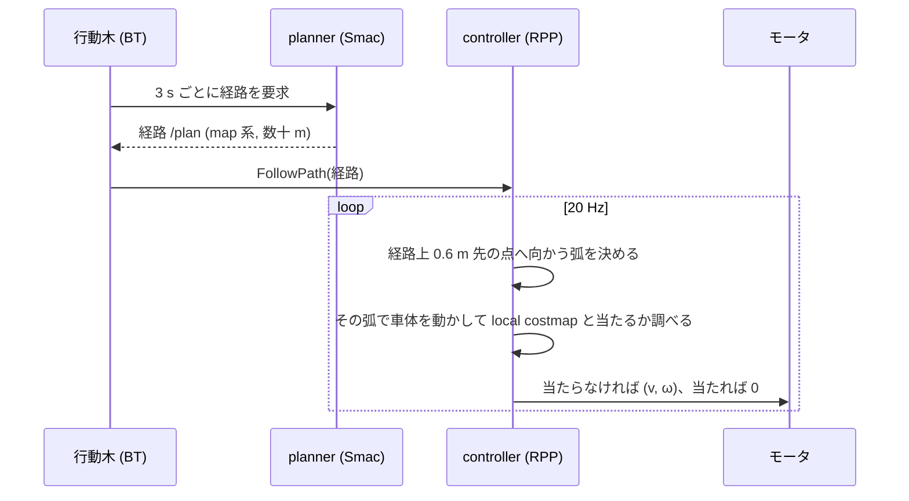
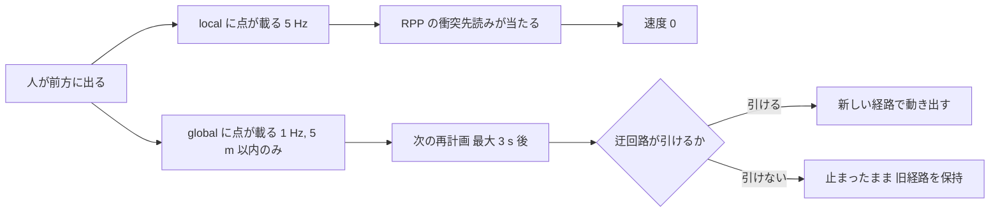

<!-- claude: 経路計画・経路追従読本 第1章 (2026-11-06) -->

# 第1章 Nav2 の役割分担 — 誰が経路を引き、誰が止めるのか

「ロボットが止まった」と一口に言っても、Nav2 の中で速度 0 を出した部品は 1 つしかない。
その部品が見ている地図と、経路を引いた部品が見ている地図は別物である。
この章では、Nav2 の 4 つの部品の役割と、2 つの costmap の違いを固める。以後の章はすべてこの分担の上に積み上がる。

## 1.1 4 つの部品

```
Nav2 の走行系
├── 行動木 (BT, bt_navigator) ...... 段取りを決める。「いつ再計画するか」「失敗したらどうするか」
├── planner (planner_server) ....... 経路を引く。start → goal の線を 1 本 (数十 m)
├── controller (controller_server) . 経路を追う。今この瞬間の速度 (v, ω) を 20 Hz で出す
└── 復帰行動 (behavior_server) ..... 詰まったときの Spin / BackUp / Wait
```

planner の出力は**線** (`nav_msgs/Path`、各点に位置と向き) であり、controller の出力は**速度**である。
controller は線を受け取って、それに沿うような速度を毎周期決める。
重要なのは、controller は**新しい線を作らない**ことだ。
線を変えられるのは planner だけで、planner を呼ぶタイミングは BT が決める。



reRoBot の BT は「追従型」で、計画が失敗しても前の経路を保持して追い続ける
(`behavior_trees/navigate_through_poses_follow.xml:48` の `RateController hz="0.333"` が 3 s 周期)。
設計は [追従型 BT の設計文書](../../features/2026-10-16_follow_bt_narrow_corridor.md) を参照。

## 1.2 2 つの costmap

costmap は「どこに何があるか」を格子に描いたコストの地図である (詳しくは第2章)。
Nav2 には 2 つあり、**読む部品が違う**。

```
global_costmap (planner_server の中に同居)
├── 読む人: planner (経路計画)、smoother (経路の平滑化)
└── 用途: 「どこを通るか」を決める。ロボットは直接これで止まらない
local_costmap (controller_server の中に同居)
├── 読む人: controller (衝突の先読み・現在姿勢の検査・減速)、BackUp / Wait
└── 用途: 「今この動きをして当たるか」を決める。速度 0 を出すのはこちら
```

reRoBot の現行設定 (`ros2_ws_main/src/bringup/rerobot_bringup/config/nav2_params.yaml`) を並べる。

| 項目 | global | local |
|---|---|---|
| 座標系 / 格子 / 大きさ | map / 0.1 m / 自機中心 200 m 角 (:256, :266) | odom / 0.05 m / 自機中心 4 m 角 (:170, :168) |
| 更新 | 1 Hz (:239) | 5 Hz (:163) |
| 静的な層 | 地図 `/map` + keepout | keepout のみ (**地図の壁は入れていない**) |
| 障害物の層の入力 | R-Fans だけ (:299) | urg + R-Fans (:202) |
| 障害物を書く距離 | 5 m まで (:317) | 25 m (実質 4 m 窓の端まで) (:217) |
| 膨張半径 | 0.65 m (:331) | 0.55 m (:230) |
| footprint | 実寸 (:252) | 実寸 (:176) |

2 つは合成されない。優先順位もない。
「近距離では local が優先される」のではなく、**planner は global しか見ず、controller は local しか見ない**。
その結果として、近距離で止まるかどうかは local だけで決まる。

## 1.3 local は迂回しない、止めるだけ

ROS 1 の move_base に慣れていると、「global planner が大まかな経路、local planner が近くの障害物を避ける短い経路を作って上書きする」と理解しがちである。
Nav2 の controller はそうなっていない。

```
よくある誤解                             実際 (reRoBot: Smac + RPP)
├── local が短い経路を高周期に作る      ✕ local 側に planner はいない
├── その経路が global を上書きする       ✕ 上書きする経路が存在しない
└── だから近くの障害物は local が避ける  ✕ RPP は避けない。弧で当たるなら止まる
```

近くに人が出てきたときの流れは次のとおりになる。



迂回できるのは global の再計画だけである。だから、

- 再計画の間隔 (3 s) と global の更新 (1 Hz) が、近くの障害物への反応速度を決める
- 迂回路が引けない (隙間が狭い・その場で回る経路が planner に無い) と、止まったまま動けない
- 「近くの物をその場でかわす」動きが欲しいなら、controller を軌道を多数試す種類 (DWB / MPPI) に替える必要がある (第4章)

## 1.4 速度の配線

controller の速度がモータに届くまでにも 2 つの部品がある。

```
controller_server → /cmd_vel_nav → velocity_smoother → /cmd_vel ─┐
joy_teleop ─────────────────────────────────────────→ /joy_vel ┴→ twist_mux → /robot_speed_cmd → epos4_controller
                                                                 (joy 優先 100 > Nav2 10)
```

bag を解析するとき、「controller が 0 を出した」は `/cmd_vel_nav`、「実際に止まった」は `/robot_speed_cmd` と車輪の位置で見る。
人がパッドで動かした区間は `/joy_vel` に現れるので、自律で抜けたのか人が抜いたのかを区別できる (事例 A の「解除は joy 介入」はこれで判定した)。

## 1.5 この章のまとめ

```
├── 経路を変えられるのは planner だけ。呼ぶのは BT (3 s ごと)
├── controller は経路に沿う速度を出すだけ。避けない、止める
├── planner は global、controller は local を見る。2 つの地図は合成されない
└── 「近くでかわす」能力は、再計画の速さか、軌道を試す controller でしか得られない
```

→ [第2章 costmap と車体の形](02_costmap_and_footprint.md)
