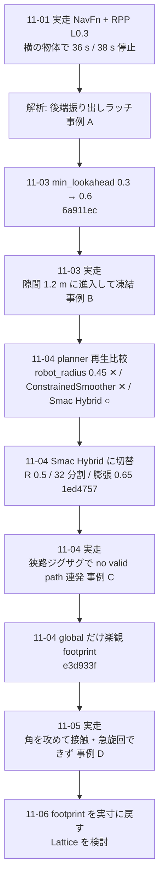

<!-- claude: 経路計画・経路追従読本 第5章 (2026-11-06、同日夜に Lattice への切替を追記) -->

# 第5章 reRoBot での構成と現在地 — どこまで来て、何が残っているか

第1〜4章の物差しで、reRoBot の現行設定を読む。
次に、11-01〜11-06 に何をどの順で変えたかを並べ、最後に残っている隙間と次の候補を整理する。
設定ファイルはすべて `ros2_ws_main/src/bringup/rerobot_bringup/config/nav2_params.yaml` (以下 `nav2_params.yaml`)。
行番号は 2026-11-06 時点 (楽観 footprint を実寸に戻した未コミット状態)。

## 5.1 現行設定の全体像

```
reRoBot の走行系 (2026-11-06)
├── BT: 追従型 navigate_through_poses_follow.xml
│   ├── 再計画 3 s ごと (RateController 0.333 Hz、xml:48)
│   ├── 計画失敗でも旧経路を保持 (連続 20 回まで)
│   └── 経路の平滑化 SmoothPath (SimpleSmoother、失敗時は未平滑)
├── planner: Smac State Lattice (11-06 夜から。それまでは Smac Hybrid-A*、R 0.5 / 32 分割)
│   ├── 動き集合 config/lattice/diff_10cm_r0.5_h16.json (0.1 m 格子・R 0.5 m・16 方位・その場旋回あり。11-07 に R0.3/16 から差し替え)
│   └── 内蔵の平滑化あり。旧 Hybrid の設定はコメントで残置
├── global costmap: map 系 0.1 m、200 m 窓、1 Hz、地図 + keepout + R-Fans (5 m)、膨張 0.65、footprint 実寸
├── controller: RPP (:93)
│   ├── 先読み 0.6〜0.9 m (:101〜:102)、衝突先読み 2 s (:116)、45° 超でその場旋回 (:119)
│   └── failure_tolerance −1 = 衝突判定が続いても失敗にせず待つ (:73)
├── local costmap: odom 系 0.05 m、4 m 窓、5 Hz、keepout + urg + R-Fans、膨張 0.55、footprint 実寸
└── 速度: velocity_smoother → twist_mux (joy 優先) → epos4_controller
```

## 5.2 footprint の前端が 0.325 m である理由

実体の前端は車軸から 0.14 m だが、footprint は 0.325 m (半幅) にしてある (`nav2_params.yaml:176` の上のコメント)。

```
前端を実体 0.14 にすると
├── 内接半径 = 中心から最も近い辺 = 0.14 m に縮む
├── 点で引く planner (NavFn) は内接半径の帯しか見ないので、半幅 0.325 未満の隙間にも線を引く
└── controller は実寸の四角で検査するので、その線を追えずに止まる
→ 前端を半幅に揃えて、内接半径 = 0.325 を保つ (10-15)
```

この水増しは「前に 0.185 m 余計に止まる」副作用を持つが、事例 A の解析で停止の主因でないことを確かめた (前端を 0.14 にしても結果は同じ)。

## 5.3 11-01〜11-06 の経緯



| 日 | 変更 | コミット | 狙い | 結果 |
|---|---|---|---|---|
| 11-03 | 先読み下限 0.3 → 0.6 | `6a911ec` | 停止中の急な弧で後ろを振らない | 11-01 型は解消 (再生)、隙間進入型には無効 (実走) |
| 11-04 | planner NavFn → Smac Hybrid | `1ed4757` | 向き付きの四角で計画し、出だしを真っ直ぐに | 至近・細い道は抜ける。狭路ジグザグは経路が出ない |
| 11-04 | global 膨張 0.55 → 0.65 | `1ed4757` | Smac の前提条件 (膨張 ≥ 外接) | 満たさないと全計画が黙って失敗 |
| 11-04 | bag 記録に RPP の掃引と旋回状態 | `1ed4757` | 次回から凍結の証拠を直接読む | — |
| 11-04 | global footprint を楽観 (幅 0.50 / 後 0.40) | `e3d933f` | 地図ずれ 0.15 m を planner に許す | ジグザグ再生 0/5 → 2/5 |
| 11-06 | global footprint を実寸に戻す | `6fe16ea` | 角の接触を防ぐ | — |
| 11-06〜07 | planner Smac Hybrid → Smac State Lattice (0.1 m・16 方位を公式ツールで生成、11-07 に R0.3 → R0.5) | 未コミット | その場旋回を planner に持たせる | 再生: 停止場面の成功・失敗は Hybrid と同じ、経路にその場旋回が入る。実走未検証 |

## 5.4 試して効かなかった・採らなかったもの

| 案 | 中身 | 結果 | 事例 |
|---|---|---|---|
| global `robot_radius` 0.45 | planner に大きい円を見せる | 自機が帯の中にいると経路が出ない。全場面で No path | E |
| ConstrainedSmoother | NavFn の経路を最適化で曲げ直す | 出だしの横ずれが直らない。始点の向き固定が「元経路の折れた向き」を固定するだけ | E |
| Smac の R を 0.3 / 0.2 / 0.1 に | 小回りを許す | 向きの刻みが粗くなり狭路の成功が 2/5 → 1/5 → 1/5 → 0/5。経路の半径は 0.74 m 未満にならない | E |
| local 格子 0.05 → 0.025 | controller の量子化を減らす | 試した 2 地点で差なし (通る所は 0.05 で通り、通らない所は接触相当) | E |
| footprint 後端を縮める | 振り出しを減らす | 実物が 0.51 なので実衝突を見逃す。0.41 でも事例 A の停止 2 は当たる | A |
| 地図の壁を 1 セル細らせる (erode) | 地図由来だけ楽観に | 未実施。楽観 footprint と違い人には楽観にならない | — |

## 5.5 残っている隙間

```
現在の構成で残っている問題
├── ① その場旋回が無い (Smac Hybrid は車用)
│     → 狭い角で向きを変える経路が出ない。経路の半径は 0.74 m 以上
├── ② 新しい障害物への反応が遅い (仮説、bag 未確認)
│     ├── 再計画 3 s・global 更新 1 Hz・global の障害物は R-Fans 5 m 以内だけ
│     └── RPP は止めるだけなので、迂回路が来るまで前に詰まり、そこから急旋回が要る → ① で詰む
├── ③ 地図ずれ (約 0.15 m)
│     → planner が見る地図の壁が現実とずれ、狭路で余裕を食う。自己位置の改善は別テーマ
└── ④ 後退が無い
      → 縁が lethal に乗った姿勢 (Start occupied、事例 E の 870 s) からは出られない
```

## 5.6 次の候補

| 候補 | 効く問題 | 手間 |
|---|---|---|
| **Smac State Lattice + Rotation Shim + RPP** | ① | 動きの集合ファイルの生成 + 再生試験。現行からの差分が最小 |
| **Smac State Lattice + MPPI** | ① ② | 上 + controller の入れ替えと調整、CPU の計測 |
| 再計画 3 s → 1 s、global 更新 1 → 2〜5 Hz | ② | 設定 2 か所。Smac は速いので負荷は許容範囲の見込み |
| global に urg を追加 | ② | 設定 1 か所。近距離の新しい障害物を planner が早く知る |
| Lattice の後退 + RPP `allow_reversing` | ④ | 切り返しを含む経路を追う挙動は実走での確認が必須 |
| BackUp を条件つきで復帰行動に戻す | ④ | 「真後ろ 0.3 m、後方 0.6 m に lethal 無し」の条件が要る |
| global 0.05 m + 窓 60 m | ③ の一部 | waypoint_runner の `--send-radius` とコースの点間隔 (≤ 25 m) が連動 |

→ [第6章 事例集](06_case_studies.md)
